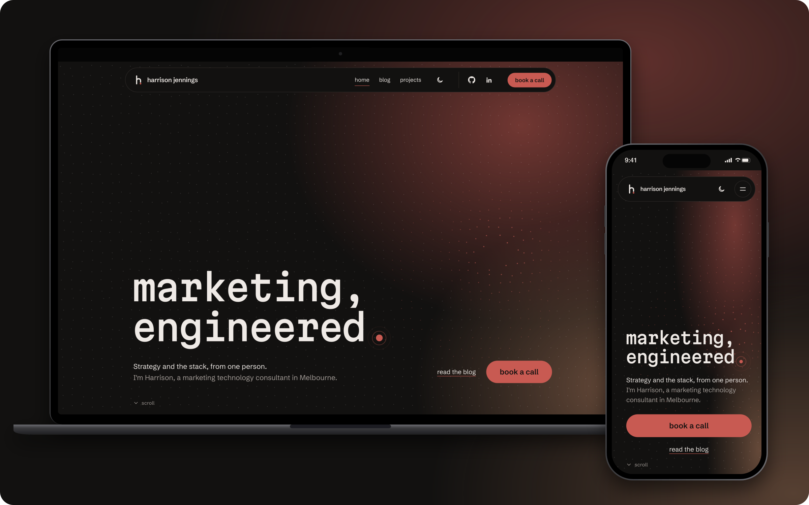

<div align="center">

<a href="https://www.harrisonjennings.au/">
  <picture>
    <source media="(prefers-color-scheme: dark)" srcset="public/brand/mark-on-dark.svg">
    
  </picture>
</a>

# harrison jennings

**the source for [harrisonjennings.au](https://www.harrisonjennings.au/)**<br>
marketing automation, analytics and measurement, creative and media strategy.

[](https://github.com/harrison-jennings/harrisonjennings.au/actions/workflows/ci-orchestrator.yml)
[](https://github.com/harrison-jennings/harrisonjennings.au/actions/workflows/cd-orchestrator.yml)
[](https://astro.build/)
[](https://developers.cloudflare.com/workers/static-assets/)
[](https://nodejs.org/)
[](tsconfig.json)
[](LICENSE)
[](https://creativecommons.org/licenses/by/4.0/)

<br>

<a href="https://www.harrisonjennings.au/"></a>

</div>

---

## what this is

A fast, static personal site: a blog, a projects index and a way to book a call. It's built with [Astro](https://astro.build/), written in Markdown in VS Code, and served from [Cloudflare Workers static assets](https://developers.cloudflare.com/workers/static-assets/). There's no CMS, no database behind the pages and no client framework; the few interactive touches are small scripts.

## how it's built

<picture>
  <source media="(prefers-color-scheme: dark)" srcset="docs/images/architecture-dark.svg">
  
</picture>

### notable engineering decisions

- **Static first.** Every page is a file. The one Worker handles requests only on `/api/*` (plus a daily retention clean-up), so a page view never runs code, and there's no client framework: a handful of small scripts, shipped as files.
- **A migration that kept its search history.** Every URL Google knew from WordPress still answers, or 301s to its new home in one hop, checked by a crawl test. Posts gained structured data, real sitemap dates, and search titles written for the queries Search Console showed.
- **Consent before measurement.** The site's own banner on CookieConsent sets Google Advanced Consent Mode v2 in `<head>`, before Tag Manager loads. Tag Manager loads first-party through `measure.harrisonjennings.au`, in front of a server-side container. Each choice is sent to a consent log in D1, with the IP address only as a keyed hash, and deleted after 12 months.
- **A Content-Security-Policy written by the build.** After each build, every inline script's hash goes into `_headers`; violations are reported to a small endpoint and counted in D1. The policy starts in report-only mode, to be enforced once the reports are clean.
- **Share cards drawn at build.** [Satori](https://github.com/vercel/satori) and sharp draw a 1200 × 630 card for every page from the brand's fonts and tokens.
- **CI and CD as orchestrators.** 🛠️ runs formatting, linting, types, unit and end-to-end tests, Lighthouse, CodeQL and dependency review as required checks. 🚀 smoke-tests every Cloudflare deploy through its version's preview address with an Access service token, and records each one as a GitHub deployment.
- **The brand as data.** `design/tokens.json` is the only source of colour and size; the site's CSS, the share cards, and the diagram and screenshot above are all drawn from it.

## quick start

Built and developed on Node 24 LTS (`nvm use` reads `.nvmrc`); Node 22.22 or newer still works.

```sh
npm ci                           # install exactly what the lockfile says
npx playwright install chromium  # once, for the end-to-end tests
npm run dev                      # http://localhost:4321
npm run verify                   # format, lint, types, unit tests, build and end-to-end tests
npm run lighthouse               # build, then Lighthouse on four pages (needs Chrome)
npm run preview                  # build, then serve dist/ through Wrangler as Cloudflare will
```

| script                      | what it does                                                  |
| --------------------------- | ------------------------------------------------------------- |
| `npm run dev`               | builds the tokens, then starts the Astro dev server           |
| `npm run build`             | builds the tokens, then the static site into `dist/`          |
| `npm run check`             | type-checks `.astro` and `.ts` files with `astro check`       |
| `npm run lint`              | ESLint, including the Astro plugin                            |
| `npm run format`            | formats everything with Prettier                              |
| `npm run tokens`            | regenerates `src/styles/tokens.css` from `design/tokens.json` |
| `npm run test`              | Vitest unit tests                                             |
| `npm run test:e2e`          | builds, then runs the Playwright tests against `wrangler dev` |
| `npm run verify`            | everything CI checks except Lighthouse, in one go             |
| `npm run lighthouse`        | builds, then Lighthouse CI against `dist/` (95+ required)     |
| `npm run readme:diagram`    | redraws the diagram above into `docs/images/`                 |
| `npm run readme:screenshot` | retakes the screenshot from a running `npm run preview`       |

## how it's put together

```text
design/tokens.json        the brand: colours (dark and light), type, spacing, radii
scripts/
  build-tokens.mjs        turns the tokens into src/styles/tokens.css
  readme/                 draws this README's diagram and screenshot
src/
  components/             Logo, Nav, Footer, Button, Consent, ProjectRow…
  content/                posts and pages (Markdown), topics, projects and the cookie list (YAML)
  content.config.ts       the schemas every entry must follow
  lib/                    helpers: posts, consent, CSP, structured data, share cards, dates
  layouts/Base.astro      the page shell: head, nav, footer
  pages/                  one file per route
  scripts/                the small client behaviours (logo draw, button wipe, nav, consent)
  styles/global.css       base styles; reads only tokens
  worker/                 the only Worker code: /api/consent, /api/csp-report, the daily clean-up
migrations/               the D1 schema: the consent log and CSP reports
public/                   fonts, favicons, brand files, _headers, _redirects, robots.txt
tests/
  unit/                   Vitest: content helpers, consent, CSP, feeds, share cards, tokens
  e2e/                    Playwright: pages, redirects, consent, headers, structured data and axe
docs/                     architecture, brand, content, deployment, decisions and the README images
wrangler.jsonc            Cloudflare Workers configuration
```

More in [docs/architecture.md](docs/architecture.md).

## the brand

Dark first, with one warm accent. The full identity, with live previews of every component, lives in the design system; [docs/brand.md](docs/brand.md) is the working summary.

| role       | dark      | light     |
| ---------- | --------- | --------- |
| ground     | `#121110` | `#F4EFEB` |
| text       | `#EFEAE6` | `#1A1615` |
| accent     | `#C85A52` | `#A8443D` |
| hover fill | `#E8A27A` | `#E8A27A` |

Type: **Martian Mono** for display, **Schibsted Grotesk** for everything else, both self-hosted.

Every colour and size in the code comes from `design/tokens.json`. Change a value there and run `npm run tokens`; don't add hex values to components.

## writing

Posts are Markdown files in `src/content/posts/<slug>/index.md`, with their images beside them, and publish at `/blog/<slug>/`. The frontmatter is checked at build time, so a typo in a date fails the build rather than the page. See [docs/content.md](docs/content.md).

## deployment

Cloudflare Workers Builds deploys `main` to production and every other branch to a private preview URL behind Cloudflare Access. See [docs/deployment.md](docs/deployment.md).

## security

Please report vulnerabilities privately; see [SECURITY.md](SECURITY.md).

## licence

Different parts, different licences; the details are in [LICENSE](LICENSE), and they match the site's [terms of use](https://www.harrisonjennings.au/terms-of-use/).

| part                                                                                           | licence                                                                                                             |
| ---------------------------------------------------------------------------------------------- | ------------------------------------------------------------------------------------------------------------------- |
| the code                                                                                       | [MIT](LICENSE)                                                                                                      |
| the writing and original graphics in `src/content/` (posts, diagrams, the site's wording)      | [CC BY 4.0](https://creativecommons.org/licenses/by/4.0/): reuse it, even commercially, with credit and a link back |
| testimonials, screenshots or logos of other people's products, and employer or client material | not mine to license: they belong to their owners                                                                    |
| the name, logo and brand identity, photos of me, the privacy policy and terms                  | © Harrison Jennings, all rights reserved                                                                            |
| the fonts                                                                                      | [SIL Open Font License](public/fonts/)                                                                              |

<sub>The diagram's logos: [Simple Icons](https://simpleicons.org/) and [SVG Logos](https://github.com/gilbarbara/logos) (CC0), Cloudflare's D1 icon from [cloudflare-docs](https://github.com/cloudflare/cloudflare-docs) (CC BY 4.0), Playwright's logo from [its docs](https://github.com/microsoft/playwright.dev), and [Twemoji](https://github.com/jdecked/twemoji) (CC BY 4.0). Each mark belongs to its owner.</sub>
