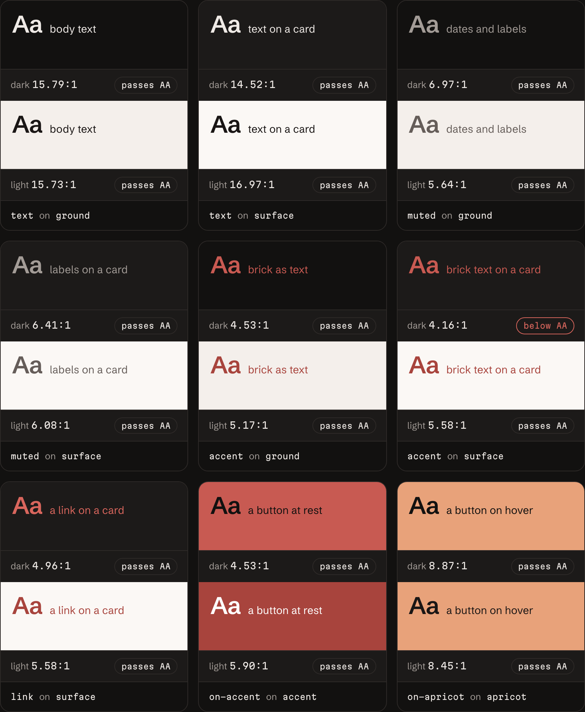

Somewhere on a shared drive at most companies is a file called something like `brand-guidelines-final-v3.pdf`.

It was beautiful the day it was exported. Since then the website has been redesigned twice, someone has added a "slightly friendlier" blue, and the email templates have quietly drifted into their own dialect. Nobody trusts the PDF, so nobody opens it, and that's why nobody updates it.

This site has brand guidelines too. They live at [design.harrisonjennings.au](https://design.harrisonjennings.au/), and they can't go out of date, because they're built from the site itself every time it deploys.

## built, not bought

When I [moved this site off WordPress](/blog/leaving-wordpress-for-the-edge/), the old site's biggest problem wasn't the hosting (although that _was_ a problem in its own right). It was that it felt like a stock theme I happened to be living in. For a site whose whole job is to represent my work, that was the wrong first impression.

So harrisonjennings.au isn't a theme with my name on it, or a template, or a component library. There's no CSS framework underneath it either. The site runs on [Astro](https://astro.build/) and a handful of small libraries; every component, style and interaction on it was designed for my brand and built specifically for it.

That means every decision is one that I actually made, rather than inherited:

- **The brand mark** is a lowercase h drawn as one continuous line, ending in a brick dot. Its line gets heavier as it gets smaller, so it reads the same at every size: the 26px mark in the nav is drawn with a heavier line than the 44px one in the booking band, not just scaled down.
- **The brick dot** that ends the logo also ends the site's big headlines. It's the brand's full stop.
- **Two themes, not one inverted.** Dark is the default, and light isn't a negative of it: it has its own deeper brick, chosen so small text still passes contrast on a pale background.
- **Two typefaces with separate jobs.** [Martian Mono](https://fonts.google.com/specimen/Martian+Mono) is the engineered voice, for anything a line or two long. [Schibsted Grotesk](https://fonts.google.com/specimen/Schibsted+Grotesk) does the reading.
- **The button wipe.** Hover a button and apricot wipes across it from whichever side your pointer came in, then leaves from the side it goes out.

Just as telling are the things that didn't make it. Before landing on a solid brick pill, the button went through a ring, a glow, a deepen, a nudge, an ember edge and a bloom. All were mocked up and compared, and all were rejected. That's what bespoke actually means: I had a reason for every choice, including the ones you'll never see.


I'm not a designer, not by any stretch. So as with some other parts of this site, I worked through the design with Claude and Claude Code. Every decision on this page was vigorously argued over, mocked up and signed off by me.

## why a bespoke brand needs a design system

A theme comes with documentation. Someone else wrote it, and someone else keeps it current.

A custom brand has no such luck. Its rules live in two places: the code, and the head of whoever designed it. That's fine on launch day, and a problem every day after, because each new page is a chance for something to drift. A colour that's nearly right. A heading one size off. A third kind of button.

This site has 84 design tokens, 26 components, 15 kinds of content a post can hold and eight page templates. That's too much to carry in my head, and too much to trust to a PDF. It needed a reference, and the reference had to be something I'd actually trust.

## a design system that can't drift

The design system is a second Astro site in the same repository, deployed to its own subdomain. The important design decision is what it doesn't do: it never keeps its own copy of anything. Everything it shows, it reads from the main site at build time.


### the examples are the real thing

Every example in the design system is the site's own component, imported from the main site's source:

```astro title="design-system/src/examples/button.astro"
---
import Button from '../../../src/components/Button.astro';
---

<Button href="/#book" label="book a call" size="l" />
<Button href="/#book" label="book a call" />
<Button href="/#book" label="book a call" size="s" />
<Button label="save choices" size="s" /> <!-- no href: a <button> -->
```

That file is also the code you copy. The preview renders it, and the code panel underneath shows the file itself (with the import written as it would be from inside the site), so the example and its code can't disagree.

Each example renders in an iframe at a true phone or desktop width: 390 or 1280 pixels, scaled down to fit when the column is narrower. That sounds like overkill until you remember how responsive layouts work. The site changes its layout based on the width of the screen, not the width of the box it's in. Squash a desktop navigation into a narrow column and you'll get a broken desktop nav, not the phone version. An iframe is a real screen of the right size, so the component does exactly what it would do on a real device.


### the facts are read, not retyped

Most documentation is retyped from the code by a person, which is where drift begins. Here, every fact the design system states is worked out from the code when it builds:

- **Props tables** are read from each component's own `interface Props`, with its doc comments and its defaults. Add a prop, and its row appears.
- **Contrast ratios** are calculated from the colours in `design/tokens.json`, in both themes, using the WCAG formula. Change a colour, and every ratio updates; if a pairing drops below 4.5:1, the page says so.
- **Logo sizes, and where each component is used,** come from reading every `.astro` file in the site's source. If I add a new `<Logo size={…}>` somewhere, the logo page lists it.
- **The front matter reference** comes from the schema every post is validated against. A new field without a description fails the build, so the reference can't fall behind the schema.
- **The footer names the commit** the design system was built from, so "what you see is what's live" is literally true.



:::tip
Documentation generated from the code has a useful side effect: it catches the places where the code and its notes disagree. Within hours of those pages being built, the token table (which shows each token's usage note) and the logo page (which lists the sizes found in the code) gave different sizes for the brand mark in the mobile menu. The note said 30px; the code said 26. The note had been wrong since the first scaffold, and nobody had noticed until two pages could be compared side by side.
:::

## 46 copies of `150ms ease`

One part of the brand had never made it into the tokens: motion.

Every colour, size and type style lived in `design/tokens.json`, but every animation timing was typed straight into a component's CSS. `150ms ease` (the timing for every hover) appeared 46 times across the codebase. Changing how the site's links feel would have meant finding all 46, and the design system's token table couldn't show motion at all.

So motion became 13 new tokens, each named after the job it does, not its value.

```css title="src/components/TextLink.astro"
/* before */
.link {
  transition:
    color 150ms ease,
    text-decoration-color 150ms ease,
    text-decoration-thickness 150ms ease;
}

/* after */
.link {
  transition:
    color var(--duration-hover) var(--ease-standard),
    text-decoration-color var(--duration-hover) var(--ease-standard),
    text-decoration-thickness var(--duration-hover) var(--ease-standard);
}
```

Naming by job matters more than it looks. A token called `duration-150` stops making sense the moment you change it to 180. And two jobs that happen to share a value today, like the consent switch and the image viewer's zoom (both 220ms), get their own tokens, so one can change without dragging the other along.

The rule for the refactor was that nothing on the site would move any differently afterwards, and it was tested like any other claim.

Before anything changed, the list of tokens was checked against the code, which turned up three places where my list was wrong. Then all 68 timings were swapped for tokens. Finally, both versions of the site were built and served side by side, and the computed styles of every element were recorded in 32 states: every kind of page, the cookie banner and preferences, the image viewer, in both themes, at both widths.

All 142,076 values were identical.


## search, without a server

With 56 pages, a sidebar only gets you so far. So the design system has search: press `/` or ⌘K from any page (or use the header, or the phone menu), and a dialog opens over the page. On a phone it takes the full screen.

Results are pages, each with up to three of the sections where your words appear, with the matches underlined in brick. Type a token's exact name, like `--accent`, and its card comes first: its value in both themes and a chip that copies it. Opening a result marks the matches on the page you land on and scrolls straight to the first one, so a match halfway down a long table doesn't leave you hunting.


It runs on [Pagefind](https://pagefind.app/), which builds a static index of the site as part of the same build, and the browser searches that index itself. There's no search server and nothing to pay for. And because the index is rebuilt with every deploy, search can't drift from the pages either. The interface is the design system's own, not Pagefind's default.

A few details only showed up once it was real:

- **Pagefind is generous with unknown words.** It answers a word it doesn't know with the longest start of it that it does, so a search for "sdf" matched every page with an "s". Results are now only kept when the page actually contains every word you typed, so gibberish finds nothing.
- **Compressed HTML ran words together.** Astro strips the whitespace between elements, so neighbouring words in the index fused into one, like a table cell's last word joined to the next cell's first. Pagefind now indexes a spaced copy of each page instead.

Search is checked by 21 end-to-end tests, covering the keyboard, the names screen readers hear, axe in both themes, and what happens when the index fails to load.

## who's this for?

**Me, writing.** When I write a post, I press `/`, type what I need, and copy its Markdown. The snippet name that inserts it in VS Code is listed with it.

**Anyone changing the site.** Each component has a page with its variants, when to use it and when not to, its props and its accessibility notes, so the next person (often me, in six months) doesn't have to reverse-engineer intent from CSS.

**Anyone deciding whether to work with me.** It's public, but deliberately unlisted for search engines. That way I can send it to a client or collaborator as evidence of how I like to work, not just a description of it.

:::note
If you work in marketing automation, this problem probably looks familiar. Your brand guidelines and your email template library are two documents that are supposed to agree and slowly don't. Marketo's tokens and snippets are the same idea at a smaller scale: define a value once, and use it everywhere. The design system just takes that idea all the way to the brand.
:::

## the only brand guidelines I trust

`brand-guidelines-final-v3.pdf` is out of date the day after it's exported.

This one is rebuilt every time the site changes, from the same code, by the same pipeline, and tested by the same checks.

I did try searching my design system for `brand-guidelines-final-v3.pdf`.

Nothing matches. Thank God.
