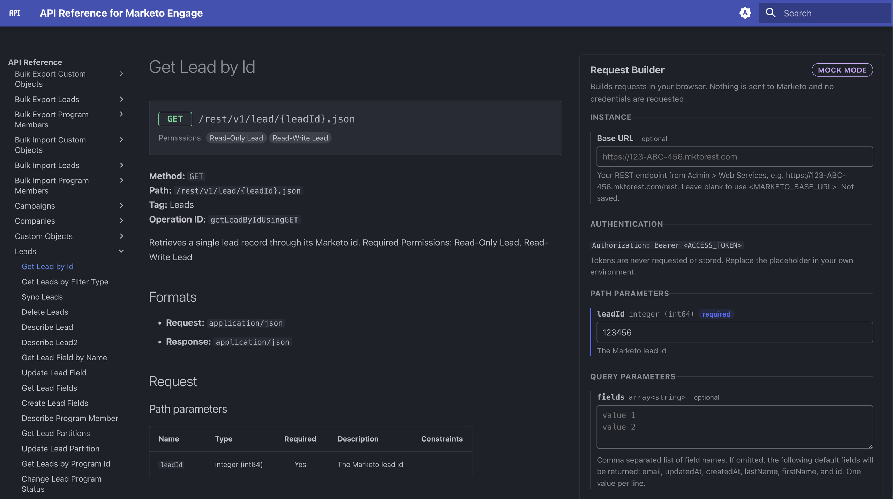
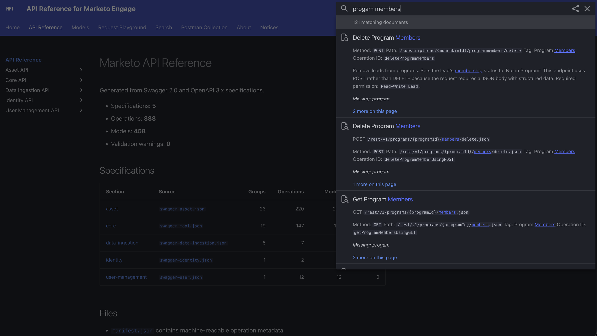
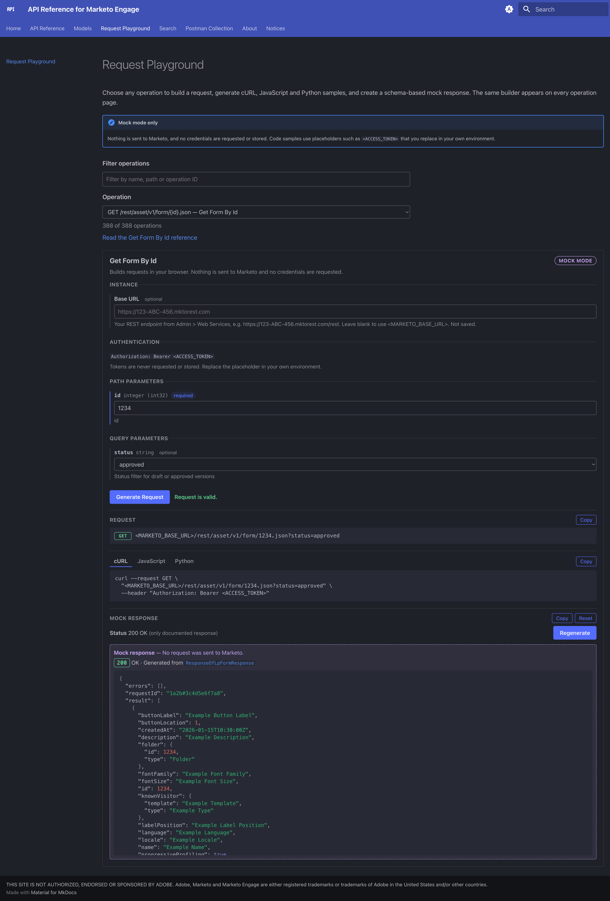
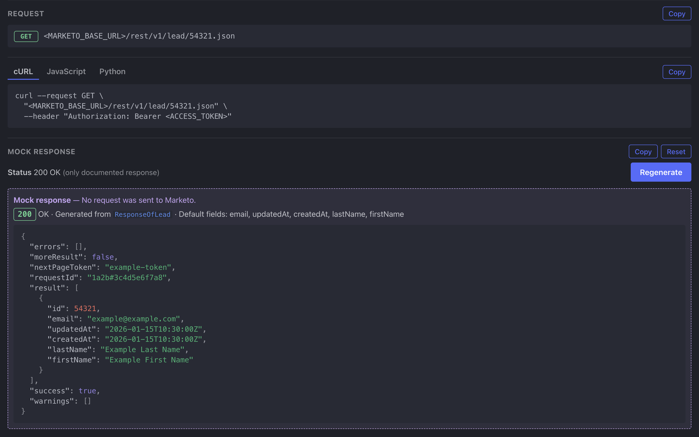
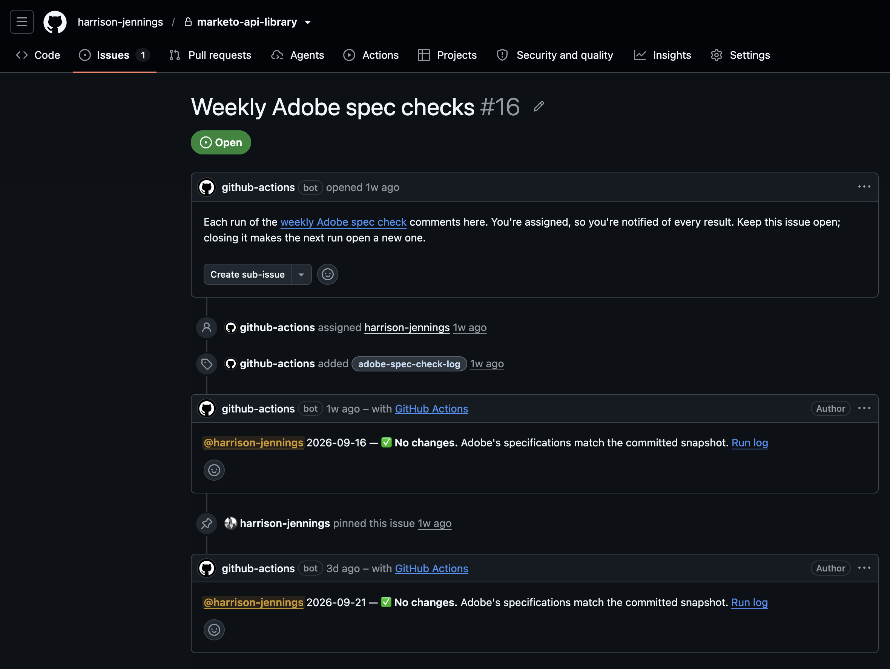
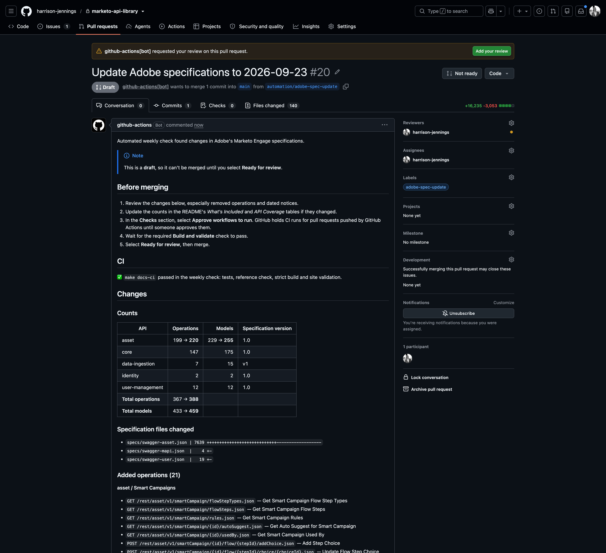

[visit the project](https://mkto-ref.harrisonjennings.au/) · [view on GitHub](https://github.com/harrison-jennings/api-reference-for-marketo-engage)

I use the [Adobe Marketo Engage REST API](https://developer.adobe.com/marketo-apis/) reasonably often, and I have always had slightly mixed feelings about its documentation.

The API itself is **excellent**. It exposes an enormous amount of Marketo: leads, activities, programs, campaigns, assets, custom objects, bulk imports and exports, administrative functions and plenty more. The documentation is also comprehensive in the literal sense. If an endpoint exists, there is generally a page explaining what it does, what method it expects and which parameters it accepts.

Where I have struggled is the gap between **_documenting the API_** and **_helping somebody construct a request against it_**.

A typical Marketo endpoint might have one or two mandatory parameters and another half-dozen optional ones. Those optional parameters are often where much of the useful functionality lives, but the request examples usually show only the minimum effort required to make the endpoint work.

Request bodies can reference shared data models, those models can contain nested properties or enumerations, and responses may use another common model shared across several completely different operations.

None of this information is missing. It is just distributed across documentation which is much better suited to answering:

> what does this endpoint do?

than:

> what _exactly_ should the request I am about to make look like?

I kept finding myself staring at request templates full of placeholders, cross-referencing optional parameters and constructing API calls that looked correct only for Marketo to politely inform me otherwise, I started wondering whether there was a better way.

Naturally, this became a project.



## what I wanted from an API reference

The initial requirement was fairly simple.

If I wanted to call a Marketo operation, I wanted to be able to find it, see **all** of the parameters available to it, enter the values relevant to my use case and have a correctly structured request produced for me.

That meant understanding more than the endpoint path itself. The system needed to know:

- the HTTP method
- path, query and header parameters
- which parameters were required
- expected data types
- permitted enumeration values
- request-body schemas
- referenced data models
- documented response codes
- response schemas
- authentication requirements

From that information it should be possible to construct the same request as cURL, JavaScript or Python without manually translating the documentation every time.

There was a second problem I was interested in solving as well.

Sometimes I don't _actually_ need to send a request yet. I needed to know what the system on the other side of an integration should expect Marketo to return.

That might be because I am developing something which will consume the response later, because the endpoint changes data and I don't want to invoke it just for testing, or simply because I want to understand the shape of the payload before I start building around it.

So ideally, the same reference would be able to tell me:

> given some operation and this request, what does a structurally valid response look like?

At that point the project stopped being a documentation site and started becoming something closer to an API modelling tool.

Fortunately, Adobe already publishes almost everything required to build one.

## starting with Swagger and OpenAPI

Adobe publishes machine-readable specifications for the Marketo APIs using [Swagger](https://swagger.io/) and [OpenAPI](https://www.openapis.org/).

And, unlike documentation written primarily for humans, an API specification has to be extremely explicit.

A machine needs to know that a particular parameter belongs in the query string.

It needs to know whether it is a string, integer, boolean or array.

It needs to know whether the parameter is required.

It needs to know the permissible values of an enumeration.

It needs to understand the shape of the request body, the models referenced by that body and the schemas behind each possible response.

In other words, almost everything I wanted already existed.

It just wasn't presented in the way I wanted to use it.

An API specification is a considerably more useful source than trying to infer API structure from rendered documentation alone, because an API specification needs to describe the interface in a form software can understand.

An operation in one of those specifications contains structured information about its path, method, parameters, schemas and responses. Shared models are represented explicitly and can be referenced by multiple operations. Constraints such as required properties, data types and enumerations can also be represented directly.

Conceptually, instead of starting with documentation like:

```
Create or Update Leads

POST /rest/v1/leads.json

Parameters:
- lookupField
- asyncProcessing
- partitionName
...
```

I could start with something closer to:

```json
{
  "method": "POST",
  "path": "/rest/v1/leads.json",
  "parameters": [...],
  "requestBody": {...},
  "responses": {...}
}
```

The important difference is not really the format.

It is that the second representation can be processed.

So I wrote a [Python](https://www.python.org/) generator which retrieves and parses the specifications Adobe publishes and turns them into a normalised reference model.

The current build processes five separate Marketo API specifications:

- Asset API
- Core API
- Data Ingestion API
- Identity API
- User Management API

Together they currently describe **388 API operations** and **459 shared data models**. It also generates a human-readable Markdown documentation for every operation and model, a machine-readable JSON definition for every individual operation, and a global operation manifest tying the whole thing together.

That gave me a much richer source of truth than any collection of manually maintained request examples could.

## normalising two generations of API specification

There was an immediate complication: not all of the specifications use the same version of the specification standard.

Some of the Marketo definitions are Swagger 2.0, while others use OpenAPI 3.x.

The concepts are similar, but the structures are not interchangeable.

For example, Swagger 2.0 commonly represents a JSON request body as a parameter:

```json
{
  "in": "body",
  "name": "input",
  "schema": {
    "$ref": "#/definitions/SomeRequest"
  }
}
```

OpenAPI 3 moves that concern into `requestBody`:

```json
{
  "requestBody": {
    "content": {
      "application/json": {
        "schema": {
          "$ref": "#/components/schemas/SomeRequest"
        }
      }
    }
  }
}
```

The location of reusable models changes as well.

Swagger uses:

```
#/definitions/...
```

while OpenAPI 3 generally uses:

```
#/components/schemas/...
```

Responses, media types and several other structures also differ.

I did not want the rest of the project to care which specification version Adobe happened to use for a particular API.

The generator therefore also acts as an abstraction layer.

It parses each source format and emits a consistent internal representation of an operation containing the information the rest of the application actually needs.

Conceptually:

```
Swagger 2.0 ─────┐
                 │
                 ├──> Python normalisation ──> common operation model
                 │
OpenAPI 3.x ─────┘
```

Once that boundary existed, the documentation renderer and Request Builder could operate on the common model rather than implementing separate Swagger and OpenAPI code paths throughout the application.

That turned out to be one of the more important architectural decisions in the project.

## generating the reference

The generator produces two representations of each operation.

The first, and arguably most boring, part is human-readable Markdown.

Each operation page includes its method and endpoint, parameters, request schema, response definitions and links to any shared models referenced by the operation.

The second is a machine-readable `.operation.json` file containing the normalised operation definition.

For example, the generated reference is structured broadly like this:

```
reference/
├── asset/
├── core/
├── data-ingestion/
├── identity/
├── user-management/
└── manifest.json
```

Within those API families are the operation documentation, data-model documentation and corresponding JSON fragments.

There is also a global manifest containing an index of every generated operation and enough metadata for the surrounding application to locate it.

This means the rendered documentation and the interactive tooling are not two independently maintained descriptions of the API.

They come from exactly the same source.

That matters quite a lot with 388 API operations.

I did not want to build a nice front end only to create another API catalogue which would gradually drift away from Adobe's actual specifications.

If Adobe changes a parameter in the source specification, the next rebuild should change both the documentation a human reads and the structured definition the Request Builder consumes.

## making the reference searchable

Once the generated reference existed, I wrapped it in a static documentation site using [MkDocs](https://www.mkdocs.org/) and [Material for MkDocs](https://squidfunk.github.io/mkdocs-material/).

That gave me navigation and full-text search across the generated content without requiring an application server or database.

The API reference can therefore be searched using things such as:

```
getLeadById
```

or:

```
program members
```

or part of an endpoint path.

This seems fairly mundane compared with the Request Builder, but it solves one of the more practical problems I have with large API surfaces.

I often know roughly _what_ operation I need without remembering _which part_ of the documentation hierarchy contains it.

With hundreds of endpoints distributed across multiple API families, being able to search the generated specification directly is much faster than navigating through several levels of documentation until I find the operation I had in mind.

So if I remember that an endpoint contains programMember, but have absolutely no recollection of where Adobe decided to put it, I can search for it. If I know the exact operation ID, I can search for that. If I've got a path from some ancient integration and want to work out what it actually does, I can search for that too.



Useful. But still mostly documentation.

The part I actually wanted was the request builder.

That is where the more interesting part of this project begins.

## building requests from the schema

Once an operation is open, the site has access to its machine-readable definition. The Request Builder does not contain a separately coded interface for each endpoint.

Instead, it reads the generated, machine-readable operation JSON and constructs the interface dynamically.

If an operation has a path parameter, it creates a control for that path parameter.

If it has optional query parameters, they are exposed as optional inputs.

If a field accepts a defined set of values, the builder can present those values rather than asking the user to know them in advance.

A relatively simple example is Marketo's **Get Form By Id** operation:

```
GET /rest/asset/v1/form/{id}.json
```

The generated operation definition contains, among other things, these two parameters:

```json
{
  "parameters": [
    {
      "name": "id",
      "in": "path",
      "description": "id",
      "required": true,
      "type": "integer",
      "format": "int32"
    },
    {
      "name": "status",
      "in": "query",
      "description": "Status filter for draft or approved versions",
      "required": false,
      "type": "string",
      "enum": [
        "approved",
        "draft"
      ]
    }
  ]
}
```

This is an abridged extract from the operation JSON rather than a separate configuration written for the front end.

From those few properties, the Request Builder already knows quite a lot.

`id` is a required integer which belongs in the URL path, so the interface can present it as a required input and substitute its value for `{id}`. `status` is optional, belongs in the query string and can only be `approved` or `draft`, so the interface can render it as an optional selector rather than expecting somebody to remember the valid values.

If I enter a form ID of `1234` and select `approved`, the builder has enough information to construct:

```
/rest/asset/v1/form/1234.json?status=approved
```



The same approach extends beyond simple path and query parameters.

For example, the **Add Leads to List** operation in Marketo's Data Ingestion API accepts a required JSON request body. Its generated operation definition points that body to the shared `ListOperationRequest` model:

```json
{
  "name": "requestBody",
  "in": "body",
  "required": true,
  "schema": {
    "$ref": "#/definitions/ListOperationRequest"
  }
}
```

That model, in turn, defines a required `listId` and an `input` array containing references to _another_ shared model, `Lead`:

```json
{
  "ListOperationRequest": {
    "required": [
      "listId",
      "input"
    ],
    "type": "object",
    "properties": {
      "listId": {
        "type": "integer",
        "format": "int64"
      },
      "input": {
        "type": "array",
        "items": {
          "$ref": "#/definitions/Lead"
        }
      }
    }
  },
  "Lead": {
    "required": [
      "leadId"
    ],
    "type": "object",
    "properties": {
      "leadId": {
        "type": "integer",
        "format": "int64"
      }
    }
  }
}
```

The Request Builder can follow those references and understand that this is not simply an arbitrary JSON field. It is a structured object requiring a list ID and one or more lead records, each of which requires an integer `leadId`.

A valid body therefore takes the form:

```json
{
  "listId": 1064,
  "input": [
    {
      "leadId": 10001
    },
    {
      "leadId": 10002
    }
  ]
}
```

This is the part of the architecture I find particularly useful. The Request Builder does not know how to construct **Get Form By Id** because I wrote logic specifically for Marketo forms, and it does not know how to construct **Add Leads to List** because I built another bespoke interface for the Data Ingestion API.

It knows how to interpret an API operation specification: where its parameters belong, which are required, what data types they accept, whether their values are constrained, and how their request-body schemas relate to shared models.

The Marketo-specific knowledge remains in the specification.

The front end provides the generic machinery for interpreting it.

That separation is what allows one Request Builder implementation to work across the whole API surface rather than gradually becoming a collection of several hundred hand-built forms.

## turning the input into an actual request

Once the relevant values have been supplied, the builder combines them according to the operation definition.

Path parameters are substituted into the endpoint path.

Query parameters are serialised appropriately.

Headers are added where required.

Request bodies are constructed from the schema.

The resulting request can then be represented in several formats.

For example cURL:

```sh
curl --request GET \
  "https://123-ABC-456.mktorest.com/rest/v1/lead/{leadId}.json" \
  --header "Authorization: Bearer <ACCESS_TOKEN>"
```

or the equivalent using JavaScript:

```javascript
const response = await fetch(
  "https://123-ABC-456.mktorest.com/rest/v1/lead/{leadId}.json",
  {
    headers: {
      Authorization: "Bearer <ACCESS_TOKEN>"
    }
  }
);

const data = await response.json();
```

or Python:

```python
import requests

response = requests.get(
    "https://123-ABC-456.mktorest.com/rest/v1/lead/{leadId}.json",
    headers={
        "Authorization": "Bearer <ACCESS_TOKEN>",
    },
)

data = response.json()
```

The code generation is not especially complicated by itself.

The useful part is that the request is assembled from the operation schema rather than from an example which may omit most of the options available to the endpoint.

And this is **considerably** nicer than playing:

> maybe the API wants this value here?

followed by:

> apparently not.

followed by another visit to the documentation.

That is the problem I was originally trying to solve.

## deliberately not executing anything

At this point it would have been quite easy to turn the Request Builder into a live API console.

I specifically decided not to.

Executing a real Marketo request would require the application to deal with actual Marketo instance information and authentication credentials. Even if those values were kept client-side, it would create a very different security profile for the site.

More importantly, I did not actually need it.

The purpose of the tool is to help construct and understand requests. Postman, cURL, an integration platform or application code can execute them perfectly well afterwards.

So the reference never asks for a Client ID or Client Secret, and it does not authenticate to Marketo.

The generated examples use placeholders for authentication information.

If you enter your Marketo base URL to make the generated examples more convenient, it stays in the browser and isn't stored.

There is no application backend involved either. The published reference is a static site, the Request Builder executes entirely in the browser, and its Content Security Policy restricts the application to loading its own resources.

That keeps a fairly useful security boundary around the project:

```
API specification
       ↓
generated operation data
       ↓
browser
       ↓
request example
```

rather than:

```
browser
       ↓
some server
       ↓
your credentials
       ↓
Marketo
```

The second architecture would solve a different problem and introduce considerably more responsibility.

## modelling the response

Once the Request Builder could understand a request schema, the next logical question was whether the same model could be used in the opposite direction.

Sometimes you need to understand the response before you have a convenient way to make a real request. Maybe you're building something downstream which needs to consume a Marketo response. Maybe you're working with an endpoint that modifies something you don't particularly want to modify just for testing. Or maybe you simply want to understand the structure without setting up credentials and burning API calls.

The specifications already describe the response schemas, so the playground uses them.

These responses can themselves contain schemas, references to common models, arrays, nested objects and primitive data types.

That means it is possible to walk over the response schema and construct a synthetic payload which has the correct shape.

The Request Builder therefore includes a mock response generator.

If the specification contains an explicit example, that can be used.

Otherwise, the generator recursively interprets the response schema and produces deterministic placeholder values appropriate to each type.

A string receives a string.

An integer receives an integer.

A boolean receives a boolean.

An array contains an item matching its item schema.

A referenced object is expanded according to the corresponding shared model.

Conceptually:

```
documented response
        ↓
response schema
        ↓
schema resolver
        ↓
synthetic JSON payload
```

This does **not** simulate Marketo's actual application logic.

If I submit a completely nonsensical value, the mock generator cannot tell me which Marketo error code the production service would return.

It is modelling the **_contract_**, not the implementation behind it.

That distinction is deliberate.

For integration development, there is still quite a lot of value in being able to say:

> if the request succeeds, this is the structure the consuming application needs to handle.

I also made the mock data request-aware where it can be done without pretending to reproduce server-side behaviour.

If a request contains multiple records, for example, an appropriate mock response can reflect that cardinality. Where input values map naturally to response fields, they can be represented in the generated output.

The result is more useful than simply printing an empty schema while remaining clearly synthetic.



## resolving the shared data models

The shared models became more significant than I initially expected.

Across the five specifications there are currently **459 data models**, and many operations refer to _them,_ rather than defining every object inline.

A response might therefore contain something like:

```json
{
  "$ref": "#/definitions/ResponseOfLeadResult"
}
```

That model can reference another object, which can contain arrays of another referenced model.

To produce useful documentation or mock data, the generator has to understand that graph.

I deliberately preserve the models as first-class reference objects rather than flattening every schema into every operation page.

There are two advantages to that.

The first is readability. If twenty operations return the same underlying model, there is no reason to duplicate its complete documentation twenty times.

The second is structural accuracy. The fact that two operations share the same model is itself useful information about the API.

So the generated operation documentation links through to the shared model definitions, while the machine-readable tooling can resolve those references when it actually needs the expanded structure.

This is one of the areas where working from the API specification rather than manually authored examples becomes particularly valuable.

The relationships already exist.

The generator just needs to preserve them.

## making the generated output reproducible

Once I had started generating hundreds of documentation files, I wanted to make sure the committed reference could always be recreated from the specifications.

The repository therefore treats generated content as generated content.

The basic relationship is:

```
specs/
   ↓
build_marketo_api_reference.py
   ↓
reference/
```

The generated reference should never need to be edited by hand.

If something in the output needs changing, either the source specification has changed or the generator needs changing.

The build process can then regenerate the complete reference deterministically.

GitHub CI checks this as well.

A build fails if the generated `reference/` content no longer matches what the generator produces from the committed specifications.

That prevents a fairly easy failure mode where somebody (i.e. _me_) modifies a generated Markdown page, commits it, and leaves the source/generator relationship inconsistent.

The published site is simply another output of that same pipeline.

## the problem with generated API documentation: it gets old

A static copy of an API specification is useful right up until Adobe changes an API specification.

Keeping a local snapshot of upstream API definitions introduces an obvious maintenance problem: a reference which was correct when generated can quietly become stale.

Manually checking five specification files every few weeks did not seem like a particularly robust solution, nor one that I was at all willing to commit to.

So I added another pipeline.

Once a week, a GitHub Action retrieves the current specifications from Adobe and compares them with the versions committed to the repository. If there are no upstream changes, it records the result against a dedicated tracking issue; if there are, it rebuilds and validates the reference and opens or updates a draft PR for review.



The workflow is roughly:

```
scheduled GitHub Action
        ↓
fetch Adobe specifications
        ↓
compare with committed versions
        ↓
no changes? ──────────────> stop and post a message to an Issue
        ↓
changes detected
        ↓
regenerate reference
        ↓
run tests, validation and CI
        ↓
open/update draft PR
```

The important part is the final step.

The workflow does **not** automatically merge specification updates.

If Adobe adds, removes or changes an API operation, I wanted this automation to identify that change and do the mechanical regeneration, but I still want to inspect what actually happened before publishing it.

The resulting pull request includes a summary of the specification differences, including changes to operation counts and added, removed or modified operations.



That gives me a useful compromise between manual maintenance and blindly trusting upstream changes.

The machine detects the change.

The machine rebuilds everything affected by it.

The machine runs the tests.

A human still decides whether the update should become production documentation.

Once I've reviewed it, I can promote the pull request from draft and merge it normally.

That merge then rebuilds the public reference.

## testing generated documentation

Because the reference is generated, a successful Python process is not enough evidence that the site is healthy.

The CI process also runs unit and integration tests around the Request Builder and validates the resulting static site.

This catches a different category of problem.

An upstream operation might still be valid OpenAPI but expose a structure my normalisation logic does not currently handle correctly.

An operation used by a Request Builder fixture might disappear.

A generated link might point to a model which no longer exists.

The MkDocs build itself might start warning about unresolved references or configuration problems.

So the CI boundary is deliberately broader than:

> did the parser exit with code 0?

It asks whether the resulting reference is internally consistent and whether the application consuming it still works.

That becomes increasingly important when the input is controlled by an upstream project.

## separating Adobe's specification from my tooling

There is also an important ownership distinction in the project.

The underlying API definitions are Adobe's.

Adobe publishes the specification files in its [`AdobeDocs/marketo-apis`](https://github.com/AdobeDocs/marketo-apis) repository under the Apache License 2.0, and the project preserves Adobe's copyright and licensing notices.

The generated reference is derived from those specifications.

The compiler, Request Builder, response-modelling logic, documentation application and maintenance automation are the tooling I built around them.

I have tried to keep that distinction explicit throughout the site.

The project is independent and is not authorised, endorsed or sponsored by Adobe, and Adobe's own documentation remains the authoritative source for the Marketo APIs.

That is also one reason I have avoided trying to make the site look like Adobe's developer documentation.

The objective was not to make an unofficial copy of Adobe's site.

It was to build a different interface over machine-readable API material Adobe already publishes.

## what I ended up with

The final architecture looks roughly like this:


What started as a request-template problem therefore became a fairly complete specification-processing pipeline.

This is exactly the sort of project I like building.

It started with a very small piece of day-to-day operational friction.

Not a catastrophic problem.

Not something that made the Marketo API unusable.

Just something I encountered frequently enough to think:

> surely this could be easier.

## what I learned

The part I find most interesting about the project is that I did not need to invent another source of API knowledge.

Almost all of the information was already there.

The Swagger and OpenAPI files know which parameters are optional.

They know which values are valid.

They know what request body a particular operation expects.

They know which shared models an operation uses.

They know the documented shape of the response.

Traditional API documentation takes that structured information and turns it into something a human can read.

I effectively wanted to stop the transformation halfway.

I still wanted the readable documentation, but I also wanted to retain enough of the underlying structure for software to work with it.

That is what makes the Request Builder possible, it is what makes mock responses possible, and it is what makes generated operation files possible.

It also means the project can continue to follow the API as Adobe changes the source specifications, rather than slowly turning into a hand-maintained snapshot of what the API looked like when I happened to build it.

There is also a broader lesson in that for documentation systems.

Documentation and tooling do not necessarily need separate sources of truth.

If the underlying specification is sufficiently structured, the same definition can drive:

> what a human reads

and:

> what a machine does.

For this project, that means the page _telling me_ that an endpoint accepts an optional parameter, and the form control _allowing me_ to enter that parameter, originate from the _same_ piece of source data.

That makes it considerably harder for those things to disagree with each other.

Which means the next time I need some obscure optional parameter buried inside one of Marketo's hundreds of REST operations, I can spend considerably less time guessing where it goes.

That was really the whole point.
