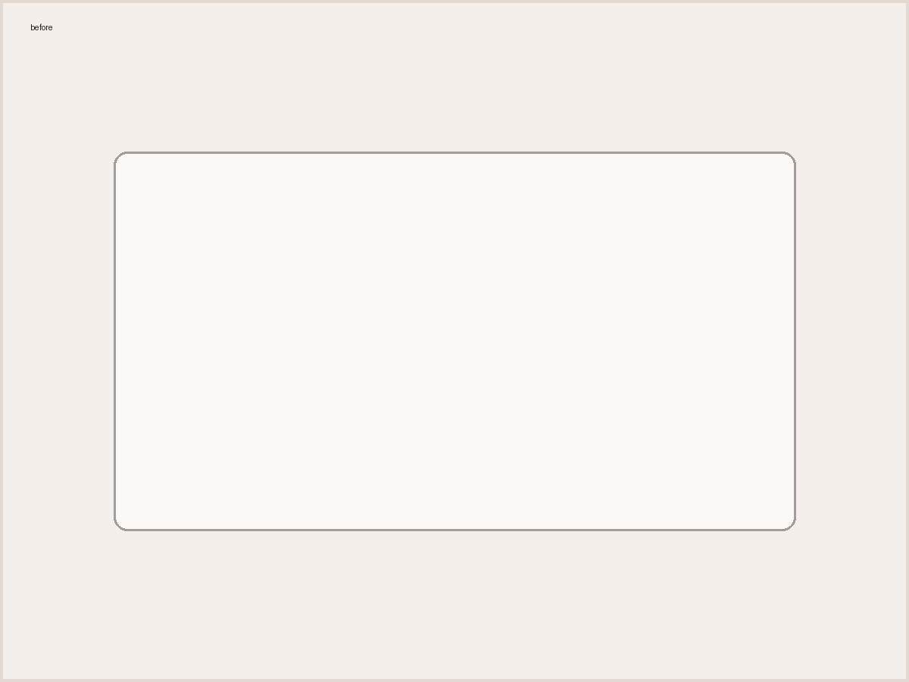
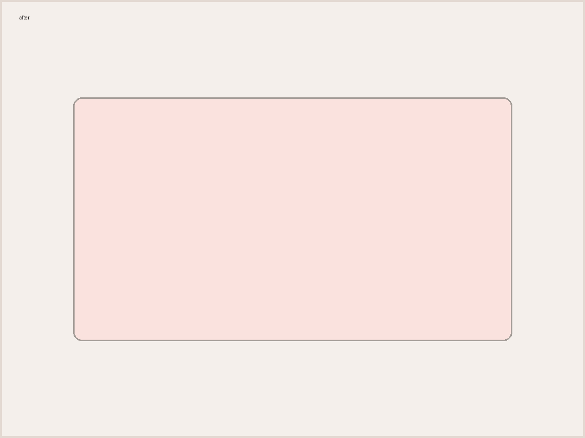
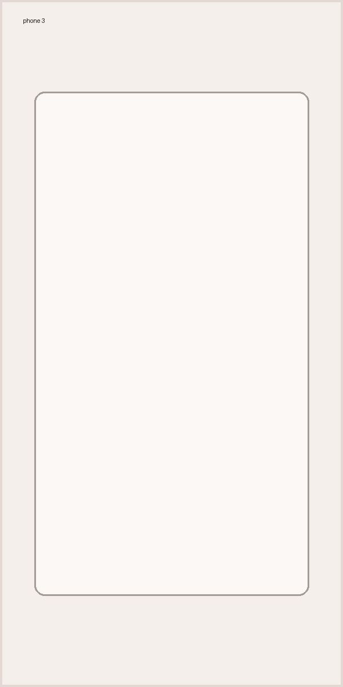
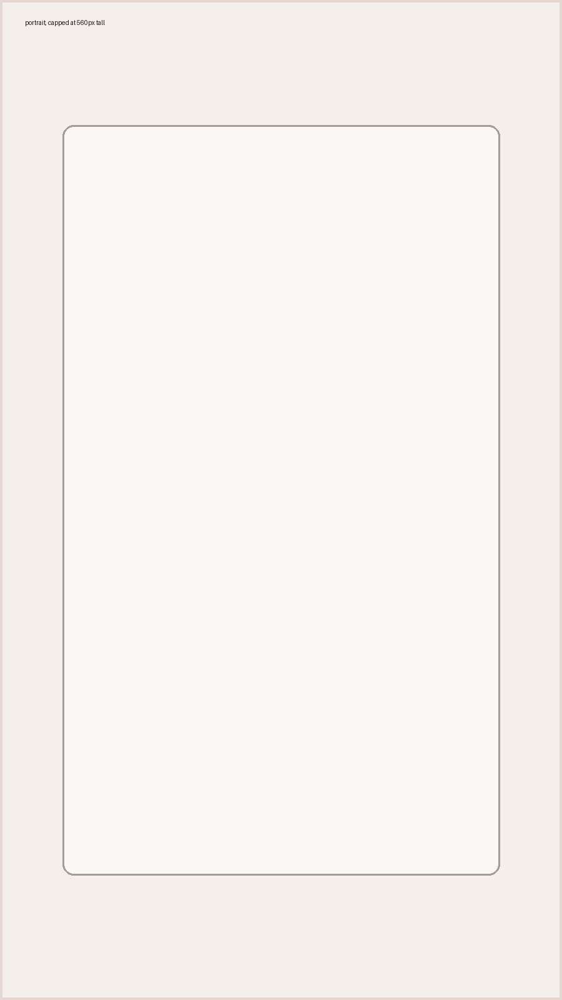

import poster from './video-poster.jpg';

Everything a post can contain, as it renders. This post is a draft, so it shows in `npm run dev` and never on the live site. Copy from it when writing.

## headings

The post title is the page's only h1, set from the front matter. `##` makes a section, listed in "on this page"; `###` a sub-section, listed indented; `####` a minor heading, not listed.

### a sub-section heading

#### a minor heading

Three levels under the title is the ceiling. Markdown's `#####` and `######` render as h4, so a deeper heading never looks like a bug.

##### a fifth-level heading renders as h4

## text

Body copy in Schibsted Grotesk with **bold for emphasis**, _italic for titles and asides_, [links underlined in brick](https://www.harrisonjennings.au/), and `inline code` for anything you'd type: a field like `$lead.Company`, a function like `isEmpty()`, or a file such as `wrangler.jsonc`. A footnote looks like this.[^1]

---

Three hyphens on their own line make the break above: three brick dots between parts of a post.

## lists

- Preview as a handful of real records.
- Check every segment of every dynamic content block.
  - Nested items indent once.
  - Use them sparingly.
- Click every link.

1. Build the email.
2. Preview it against the test list.
3. Send the test.

## quotes and callouts

> A test send proves the email can work. It doesn't prove it works for everyone it's about to reach.

:::note
Background or a side point the reader can skip.
:::

:::tip
A shortcut or a better way to do the thing being described.
:::

:::warning
Something that will break or cost money if it's missed.
:::

## code

```js
// load the calendar only after someone asks for it
button.addEventListener('click', () => {
  loadCalEmbed({ timeout: 8000, theme: 'dark' });
}, { once: true });
```

```js title="src/scripts/booking.js"
// load the calendar only after someone asks for it
button.addEventListener('click', () => {
  loadCalEmbed({ timeout: 8000, theme: 'dark' });
}, { once: true });
```

```vtl {2-3}
## fall back when the first name is missing
#if( $lead.FirstName.isEmpty() )
  #set( $greeting = "Hi there" )
#else
  #set( $greeting = "Hi ${lead.FirstName}" )
#end
${greeting},
```

```sh
$ npm run build
$ npx wrangler dev
```

Keys stay in text colour, and values take the string colour, in JSON and YAML alike:

```json
{ "name": "harrisonjennings.au", "port": 4321, "private": true }
```

```yaml
name: harrisonjennings.au
port: 4321
kept: 6 months
```

```js
const utm = new URLSearchParams({ utm_source: 'newsletter', utm_medium: 'email', utm_campaign: 'october-launch', utm_content: 'hero-button' });
```

```
A block with no language is plain text: nothing is highlighted.
```

## images


<Figures cols={2} caption="Before and after: the same email with and without a fallback.">
   
</Figures>

<Figures cols={3} caption="Apple Mail, Gmail and Outlook on iOS.">
    
</Figures>

A portrait image is capped at 560px tall and centred, so it never fills the screen:



Add `{nozoom}` straight after an image to leave it out of the image viewer (in an `.mdx` post, write it as `\{nozoom}`):

\{nozoom}

## tables

Right-align a column (`---:`) to set its numbers in Martian Mono.

| client            | renders                         | share |
| ----------------- | ------------------------------- | ----: |
| Apple Mail        | as built                        |   54% |
| Gmail             | strips some styles              |   27% |
| Outlook (desktop) | Word engine: no rounded corners |    8% |

## embeds and extras

<YouTube id="dQw4w9WgXcQ" title="A sample video" />

With a still frame saved beside the post and imported at the top (`import poster from './video-poster.jpg';`), it shows behind the play button, served from this site:

<YouTube id="dQw4w9WgXcQ" title="A sample video with a poster" poster={poster} />

<details>
<summary>show the full script</summary>

Long scripts and asides go here, closed by default.

</details>

[^1]: Footnotes are for sources and asides that would interrupt the sentence.
