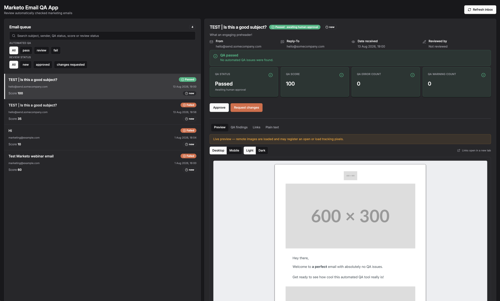
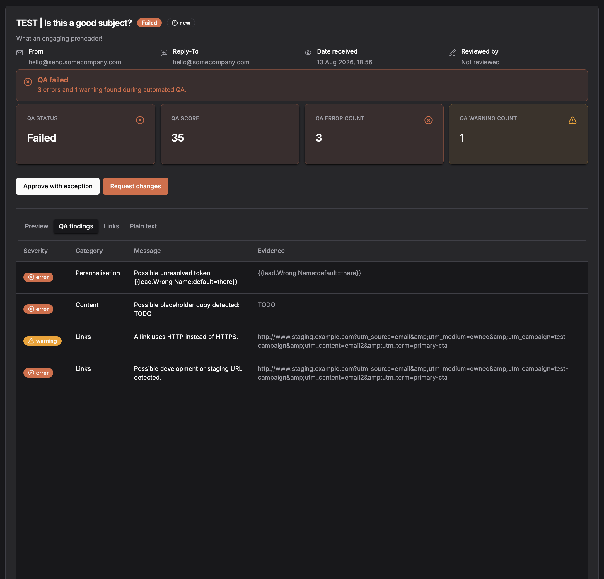
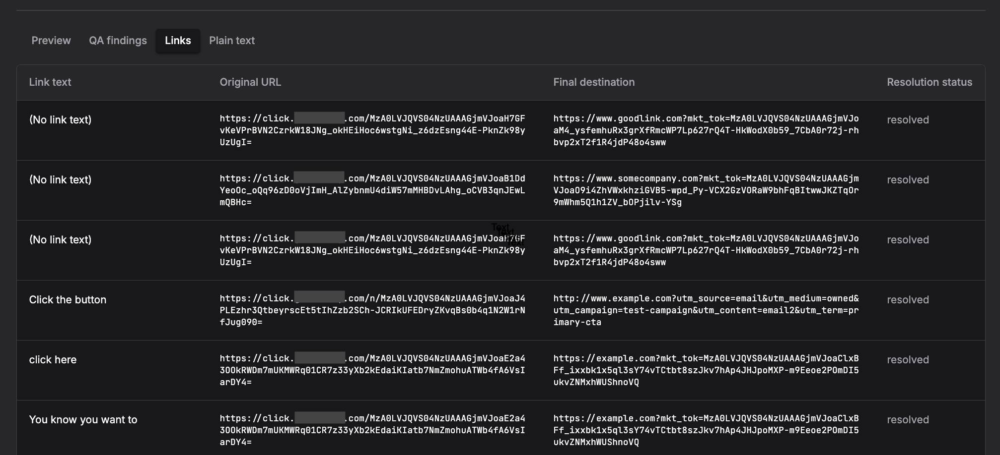
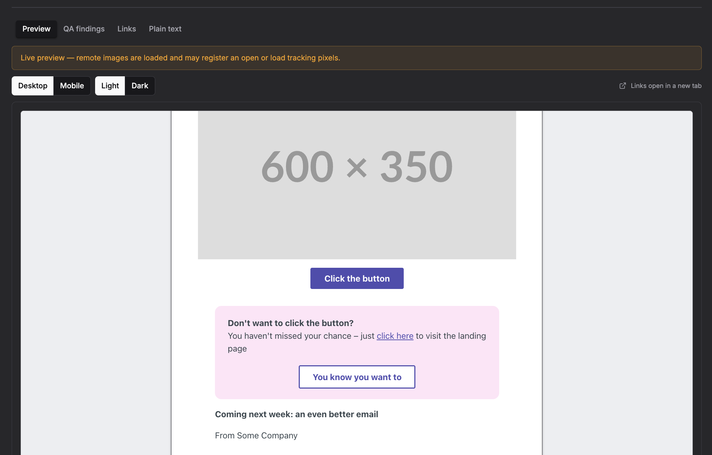
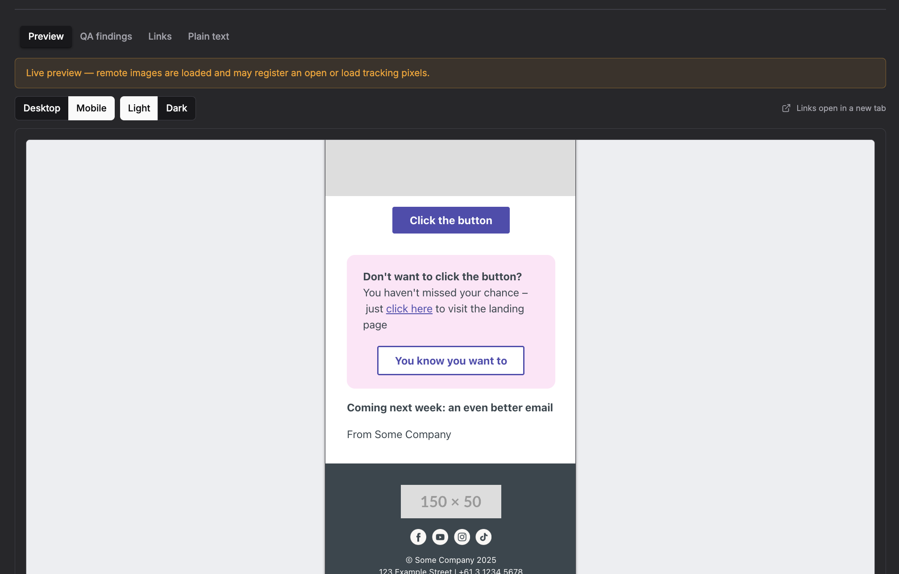
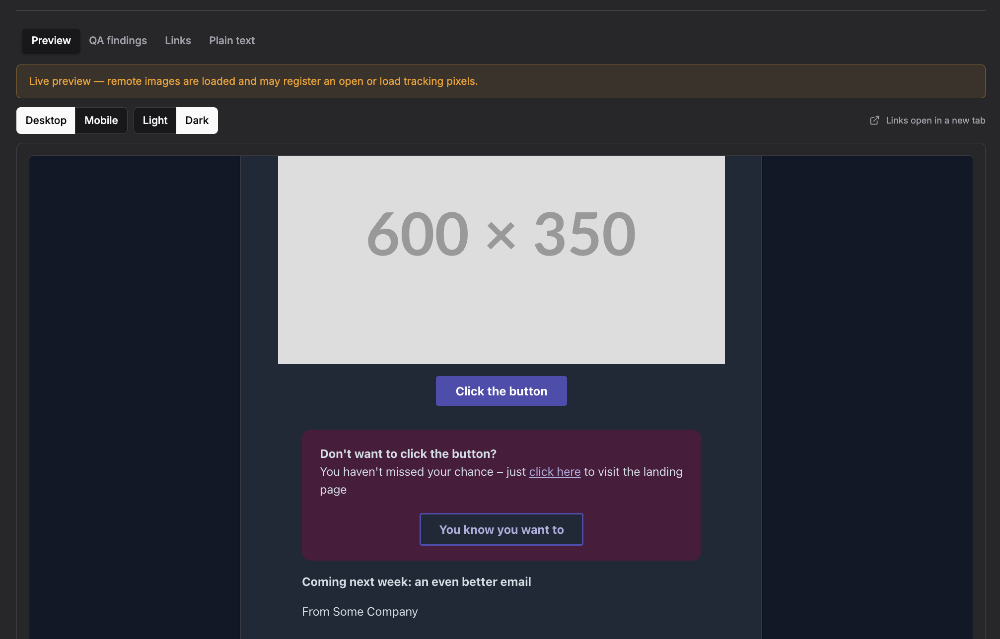
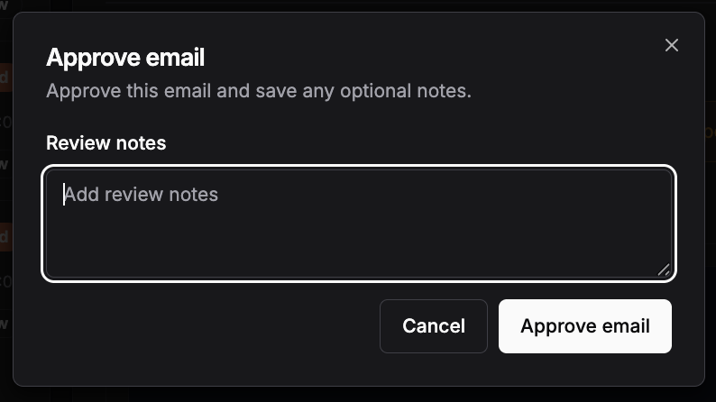
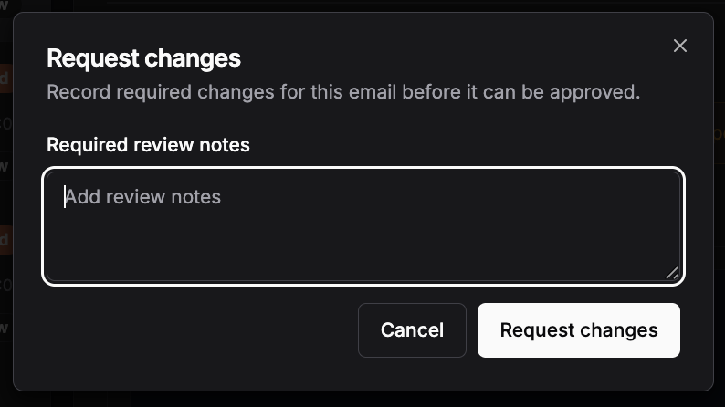
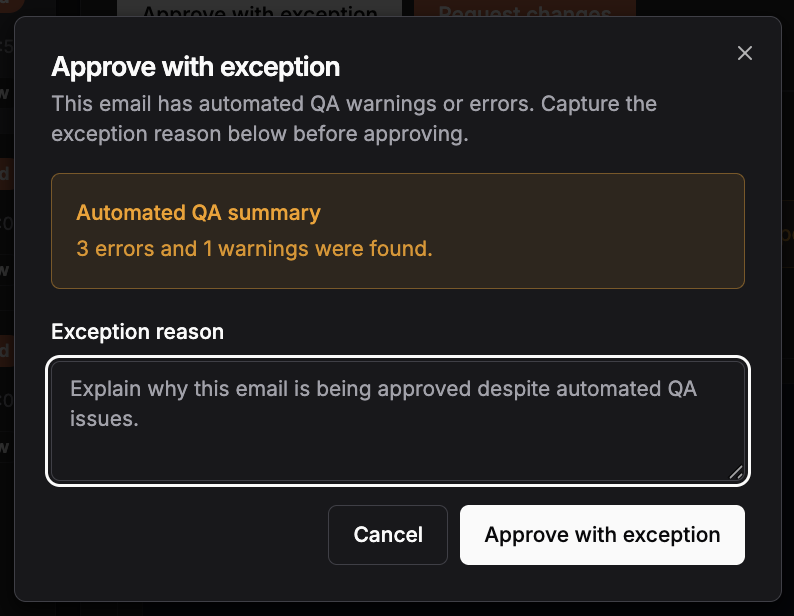

If you work in marketing automation, you probably have a version of the same pre-send ritual.

Send yourself a sample. Check the subject line. Read the copy. Click every link. Check the footer. Squint at it on your phone. Send it to somebody else and ask whether it “looks weird” in Outlook. Go back into [Marketo](https://business.adobe.com/au/products/marketo.html), fix the thing you inevitably missed, and start again.

It works.

Mostly.

The problem is that it also relies on a human remembering every single thing that needs to be checked, every single time.

I wanted something better.

Not necessarily a replacement for human QA - I am definitely not brave enough to let a script decide whether an email is ready to send to several hundred thousand people - but a system that could do the boring, mechanical checks automatically and present everything a human reviewer needs in one place.

So naturally, what started as “could I automate a few email QA checks?” became an inbound email service, a Retool Workflow, a JavaScript QA engine, a Python redirect resolver, a Postgres database, a React application and a surprisingly complicated dark mode simulator.

Standard stuff.

## what did I need to do?

The objective was relatively straightforward.

I wanted somebody building an email in Adobe Marketo Engage to be able to send a normal sample email to a QA address.

From there, without them doing anything else, I wanted the system to:

- ingest the email
- capture both its HTML and plain-text versions
- inspect the content for common QA problems
- extract every link and image
- work out where Marketo tracking links actually go
- give the email an automated QA result
- store everything for later review
- render the email safely in a browser
- allow a reviewer to approve it, reject it, or approve it with an exception

Importantly, I didn't want people copying HTML out of Marketo, uploading `.eml` files, filling out forms or learning another QA process.

The workflow needed to start the same way QA already started:

> **send a sample email.**

Everything after that could be somebody else's problem.

In this case, mine.

## the architecture

The eventual architecture looks roughly like this:


There is also a secondary backfill workflow for older records. That became useful while I was iterating on the link-resolution logic because, unsurprisingly, I did not get every part of it right on the first attempt (more on this soon).

## why Postmark?

The first question was how to get a real Marketo sample email into the system.

I could have created some kind of upload flow where a user exported HTML and pasted it into Retool, but that immediately creates another process people have to remember.

I wanted the sample email _itself_ to be the API call.

Postmark has an inbound email capability which does exactly what I needed. You send an email to a dedicated inbound address and Postmark parses the message before making an HTTP request to a webhook.

That means the ugly parts of receiving email - MIME boundaries, HTML versus plain text, sender parsing and all the other things I had absolutely no interest in implementing myself - are dealt with before the message reaches my code.

So, the user experience is simply:

```
Marketo
  ↓
Send Sample
  ↓
qa@some-inbound-address
```

Postmark receives the sample, turns it into structured data and POSTs that payload (pun intended) to the webhook endpoint on my Retool Workflow.

That payload gives the workflow what it needs to work with the message: its subject, sender and recipient information, HTML body, text body and external message identifier.

At this point, the email has gone from being a message in somebody's inbox to being structured application data.

Which is _obviously_ much more fun.

## using Retool as the glue

I decided to build the rest of the system in [Retool](https://retool.com/).

This turned out to be particularly useful because the project really had three different requirements:

1. server-side orchestration
2. persistent data storage
3. an internal user interface

Retool gave me all three in one environment.

The Workflow handles ingestion and processing.

Retool Database stores the email and its QA results.

The Retool App provides the review interface.

It also meant I could mix technologies inside the workflow rather than forcing everything into one language. Most of the email analysis makes sense in JavaScript, while HTTP redirect processing ended up being considerably easier to control in Python.

The primary workflow is deliberately quite small:

```
startTrigger
    ↓
runQA
    ↓
resolveLinks
    ↓
saveEmail
```

Each block has one job.

That separation turned out to matter quite a lot as the application became more complicated.

## the JavaScript QA engine

The first processing step is `runQA`.

This is where the email stops being a blob of HTML and starts turning into a QA report.

The JavaScript receives and parses the inbound Postmark payload, normalises the fields I care about and analyses the content.

The checks are grouped broadly into:

```
Subject
Personalisation
Content
Links
Images & accessibility
Compliance
```

Rather than simply returning `true` or `false`, the script creates individual findings.

A finding has a category, severity, human-readable explanation and, where useful, the piece of evidence that caused it.

For example:

```json
{
  "message": "Possible unresolved token: {{lead.First Name}}",
  "category": "Personalisation",
  "evidence": "{{lead.First Name}}",
  "severity": "error"
}
```

Or:

```json
{
  "message": "A link uses HTTP instead of HTTPS.",
  "category": "Links",
  "evidence": "http://staging.example.com/register",
  "severity": "warning"
}
```

This distinction is important.

A QA tool that just says **FAIL** is not particularly useful. The reviewer still has to go hunting for the reason it failed.

The output of this script is designed to explain itself.

### some of the checks

The QA engine can identify things like unresolved personalisation tokens:

`{{lead.First Name}}`

It can look for placeholder content that should never make it into a production email:

```
TODO
Lorem ipsum
placeholder
```

It can identify insecure HTTP links, suspicious development or staging URLs and missing compliance links.

Images are extracted so they can be counted and inspected as part of the QA result.

The script also extracts every anchor in the email into a structured array.

Something like:

```json
{
  "text": "Run the numbers",
  "url": "https://click.example.com/abc123"
}
```

That sounds simple, until Marketo gets involved.

## the Marketo tracking-link problem

The link displayed in a Marketo email usually isn't the link the email author actually entered. Marketo wraps tracked links with its own redirect domain.

So something conceptually like:

`https://www.example.com/book`

might arrive in the actual email as:

`https://click.example.com/very-long-tracking-token`

If my QA system only looked at the HTML, it could tell me that the tracking URL was valid. It could not tell me whether the actual destination was valid. That matters.

A beautifully formed Marketo tracking URL can still redirect to:

`https://staging.example.com`

or the wrong landing page.

For meaningful link QA, I needed both values:

```
original URL
     ↓
Marketo tracking URL
final destination
     ↓
actual page after redirect
```

Which is where Python entered the picture.

## resolving links with Python

The `resolveLinks` function receives the links extracted by the JavaScript QA engine.

It does not blindly open every URL. That would be unnecessary, slow and, depending on the destination, potentially capable of triggering things I really don't want a QA process triggering.

Instead, each link is classified first.

A normal direct URL can simply be recorded as direct:

```json
{
  "resolution_status": "direct",
  "final_url": "https://www.example.com/page"
}
```

Non-HTTP actions such as:

```
mailto:
tel:
```

don't need redirect resolution at all, so they are skipped.

Direct unsubscribe and preference-management URLs can also be identified without following them. The last thing I wanted my email QA tool doing was accidentally unsubscribing the test recipient while trying to be helpful.

Tracking URLs on the configured Marketo tracking host are the links that actually need resolving.

There is an important distinction here, though: **the resolver doesn't open the destination in the way a browser does.**

What I actually care about is the redirect information.

When the Python script requests a Marketo tracking URL, the server responds with an HTTP redirect telling it where to go next. The resolver inspects that response, records the destination and follows the redirect chain as required.

But once it has identified the final destination, it stops.

It doesn't render the landing page. It doesn't execute JavaScript. It doesn't load images, analytics libraries or tracking pixels. There is no browser sitting there waiting for the page to finish loading.

That gives me the information I need for QA without turning the link checker into a tiny web browser.

The Python step requests those URLs, inspects the redirect behaviour and enriches each link with information including:

```json
{
  "original_url": "https://click.example.com/abc123",
  "final_url": "https://www.example.com/book",
  "http_status": 302,
  "redirect_count": 1,
  "redirect_chain": [],
  "resolution_status": "resolved"
}
```

The exact status varies depending on what happened - resolved, direct, skipped, error and so on - but the important bit is that the QA record now understands the difference between the tracking link in the email and the page the recipient ultimately reaches.

I also deduplicate URLs before processing them.

Email templates contain a surprising amount of repeated linking: logos, desktop/mobile variants, footer icons and duplicate calls-to-action can all point to the same URL.

There is no reason to make the same HTTP request ten times just because the same destination appears ten times in the HTML.

The resolver processes each unique URL once, then maps the result back onto every matching link.

### why wasn't this JavaScript too?

Originally I assumed the whole QA process would live happily inside one JavaScript block.

Of course it didn't. Mostly because I just couldn't get it to work.

Once outbound HTTP requests and redirect behaviour were involved, splitting that work into a dedicated Python step gave me much cleaner control over the network operation and the resulting data.

It also established a useful architectural boundary:

```
JavaScript = understand the email
Python     = understand the destination URLs
```

The JavaScript does not need to care how an HTTP redirect works.

The Python script does not need to know what constitutes a missing preheader or unresolved Marketo token.

That separation makes both scripts easier to reason about.

## combining the result

Once the links have been resolved, those results are merged back into the automated QA object.

A stored QA result ends up looking conceptually like:

```json
{
  "score": 100,
  "status": "pass",
  "error_count": 0,
  "warning_count": 0,
  "link_count": 20,
  "image_count": 11,
  "findings": [],
  "links": [],
  "images": [],
  "checked_at": "2026-08-01T09:12:54.568Z",
  "link_resolution": {
    "tracking_host": "click.example.com",
    "input_link_count": 20,
    "unique_url_count": 18,
    "truncated": false,
    "counts": {
      "resolved": 16,
      "direct_action": 2
    }
  }
}
```

I deliberately store the detailed result rather than just the final score. Scores are useful for scanning a queue. Structured evidence is useful when somebody actually needs to work out what is wrong.

## storing everything in Retool Database

The final Workflow step writes the processed email to a `qa_emails` table. I decided to keep both the raw message content and the derived QA data.

The database record includes things like:

```
message metadata
raw HTML and plain text
extracted preheader
automated QA status and score
detailed QA results
```

Then there is a separate set of fields for human review:

```
status
reviewed_by
reviewed_at
review_notes
exception_reason
qa_override
```

This distinction between **automated QA state** and **human review state** is quite important.

An email can have:

```
Automated QA: Passed
Human status: New
```

because passing an automated check does not mean somebody has approved the campaign.

Likewise:

```
Automated QA: Failed
Human status: Approved
QA override: true
```

is possible when the reviewer has deliberately accepted an exception.

Maybe a particular warning is expected. Maybe there is a legitimate business reason for it.

The system shouldn't prevent that decision. It should make sure the decision is explicit.

## building the front end

Once the data pipeline worked, I needed somewhere people could actually review it.

The front end is a React/TypeScript application running inside Retool, with the database queries and review mutations sitting behind the UI. The basic layout is a review queue on the left and the selected email on the right.



The queue can be filtered by automated status:

```
Passed
Needs review
Failed
```

and human status:

```
New
Approved
Changes requested
```

There is also search so a reviewer can find a campaign without scrolling through every sample email anyone has sent to the QA address.

Selecting an email loads the full review workspace.

At the top are the things I want somebody to understand immediately:

- automated QA state
- QA score
- error count
- warning count
- human approval state

Below that, the detail is broken into tabs:

```
Preview
QA findings
Links
Plain text
```

### QA findings

The findings tab takes the structured findings generated by `runQA` and turns them into something readable.

Instead of making somebody inspect a JSON object, they see:



When a category has no problems, the UI can also make that explicit:

```
Subject checks passed
Personalisation checks passed
Content checks passed
Link checks passed
Image and accessibility checks passed
Compliance checks passed
```

There's a surprisingly meaningful difference between:

> I didn't see any errors.

and:

> The system checked this category and it passed.

### the links tab

This is one of my favourite parts.



For every extracted link, the reviewer can see:

```
Link text
Original URL
Final destination
Resolution status
```

So rather than hovering over a Marketo tracking URL and hoping for the best, the reviewer can immediately verify where the recipient will actually end up.

For direct URLs, the system simply identifies them as direct.

For tracked URLs, both the original tracking address and resolved destination are retained.

That also means link-resolution failures are visible rather than silently ignored.

## rendering arbitrary email HTML safely

The preview presented a different problem: I am storing arbitrary HTML received over email.

I definitely do not want to just throw that HTML directly into my application's DOM and hope everybody involved had good intentions. The preview therefore has two layers.

The first is `emailHtml.ts`.

This utility parses and sanitises the incoming document before it ever reaches the iframe.

It removes things like:

```
script
iframe
frame
frameset
object
embed
applet
form
```

It also strips inline JavaScript event handlers and unsafe URL behaviour. Links are forced to open in a new tab with appropriate isolation. The email's styles, tables and legitimate content remain intact.

The second layer is `EmailPreviewFrame.tsx`.

The cleaned document is rendered inside a sandboxed iframe. Scripts are not permitted.

The iframe _does_ allow same-origin access because the React component needs to inspect the generated document to calculate its rendered height, but arbitrary scripts inside the email still cannot run.

There is one unavoidable catch: remote images are real remote images.

If the email contains:

``

then displaying the preview may request it. That request may register as an open.

So the UI explicitly warns reviewers:

> Live preview - remote images are loaded and may register an open or load tracking pixels.

Of course, for native Marketo sample emails this isn’t an issue as even tracked links via the click domain don’t _actually_ track anything. But in the case where a _real_ email needs to be sent for QA, this will absolutely log any triggered events in the Marketo Activity Log.

I'd rather make that behaviour visible than pretend browser rendering is somehow consequence-free.

## desktop and mobile previews

The preview can switch between desktop and mobile widths.

This isn't pretending to be a full Litmus-style client rendering service.

It is simply giving the browser a different viewport so the email's responsive CSS can behave the way the author intended.

<Figures cols={2}>
  
  
</Figures>

The useful part is speed.

A reviewer can switch:

```
Desktop | Mobile
```

without forwarding the message to another device or resizing a browser window manually.

It won't tell me whether Outlook 2016 has decided to wage war against a particular table cell.

Nothing can truly prepare you for that.

But it catches the much more common responsive-layout issues quickly.

## then I accidentally built dark mode

At some point I thought: it would be useful to preview the email in dark mode.

This was, in retrospect, an extremely effective way to create more work for myself.

There are two fundamentally different cases.

<Figures cols={2}>
  
  
</Figures>

### when the email has dark-mode CSS

Some emails explicitly define styles like:

```css
@media (prefers-color-scheme: dark) {
  .container {
    background: #111111;
  }
  .copy {
    color: #ffffff;
  }
}
```

Others include Outlook-oriented selectors such as:

```css
[data-ogsc]
[data-ogsb]
```

If the email has authored dark-mode behaviour, the preview should respect it.

So `emailHtml.ts` detects that support and activates the email's existing dark-mode rules for the dark preview.

The application doesn't invent a new colour scheme on top of it. The email designer wins.

### when the email doesn't have dark-mode CSS

Plenty of emails don't define dark mode at all.

They contain things like:

```html
<table bgcolor="#ffffff">
```

and:

```html
<td style="color:#39464e">
```

There is nothing for the browser to “switch on”.

So, for those emails I added an explicitly simulated dark mode.

I initially made the obvious mistake of transforming foreground and background colours independently.

That worked beautifully until it didn't.

A pale pink callout stayed pink, its dark text changed to white and the whole thing became almost unreadable.

Which is a useful reminder that colour transformation is a contrast problem, not simply a light-versus-dark problem.

The current simulator uses a more general approach.

First, it examines the browser's computed background colours and transforms sufficiently light surfaces into dark equivalents.

For coloured surfaces it attempts to preserve the hue rather than replacing every background with the same charcoal grey.

Then, after those backgrounds have changed, it recalculates the rendered styles and checks the actual contrast between foreground text and the effective background behind it.

Text only changes when the contrast is no longer sufficient.

So conceptually:

```
light pink + dark text
        ↓
dark pink + light text
```

but if the pink background can't safely be transformed:

```
light pink + dark text
        ↓
light pink + dark text
```

The important thing is that the text remains readable.

Images, SVGs, video and elements using background images are deliberately left alone because automatically recolouring creative assets would be a fantastic way to make the preview look authoritative while being completely wrong.

The result is still only a browser-based simulation.

It is not Litmus.

It is not Gmail.

It is not Outlook.

It is definitely not “whatever specific version of Outlook somebody in Sales is somehow still using”.

But for emails with no authored dark-mode support, it gives the reviewer a useful approximation without hard-coding rules for a particular brand or template.

## human approval

The last part of the application is deliberately not automated.

A reviewer can:

```
Approve
Request changes
Unapprove
```

<Figures cols={3}>
  
  
  
</Figures>

If the email has automated warnings or errors, approving it becomes:

> Approve with exception

and the reviewer has to record why.



That gives me a useful balance: automation finds repeatable problems, humans make judgement calls, the database records both.

I didn't want automated QA to become a gate that people learned to work around. I wanted it to provide evidence.

There is a big difference between:

> _The system says no._

and:

> _The system found four things you should look at before saying yes._

The second one is much more useful.

## building the backfill workflow

One advantage of storing the detailed QA result as JSON is that I can improve parts of the system without rebuilding everything.

When I significantly changed the redirect-resolution logic, I already had emails in the database that contained the old link results and data model.

Deleting them and sending every sample again would have been ridiculous and annoying.

So I built a second workflow:

```
getEmailsToBackfill
        ↓
resolveExistingLinks
        ↓
prepareUpdates
        ↓
updateEmails
```

The database query selects records requiring updated link data.

A Python step re-runs the resolution logic.

JavaScript reconstructs the updated QA result while preserving the rest of the original analysis.

SQL writes the enriched JSON back to the record.

This has turned out to be generally useful because it lets the schema remain stable while individual parts of the analysis evolve.

## what I learned

The interesting part of this project wasn't really any one piece of code.

None of the individual components are especially exotic.

- Postmark receives email.
- JavaScript inspects HTML.
- Python resolves redirects.
- Postgres stores JSON.
- React displays it.

The useful part is what happens when those fairly ordinary pieces are joined together around a very specific operational problem.

A few things became particularly obvious while building it.

### automate evidence, not judgement

I don't think a marketing QA tool should be responsible for deciding whether an email deserves to exist.

It should be extremely good at finding things humans are bad at repeatedly checking with consistency.

- Missing links.
- Unresolved tokens.
- Placeholder copy.
- Suspicious URLs.
- Accessibility issues.
- Compliance components.

Then it should present those findings to somebody who understands the campaign.

### keep raw data

Storing the original HTML and text alongside the processed QA output has made the system much easier to evolve.

If I improve the front-end renderer tomorrow, I don't need another sample email.

If I change link processing, I can backfill.

If I add another QA check, the source material still exists.

Derived data is replaceable.

The source email isn't.

### tracked URLs are not destinations

This seems obvious in retrospect, but it changed how I thought about link QA.

Checking that:

`https://click.example.com/abc123`

exists tells you very little.

The destination is what matters.

Any automated QA system sitting downstream of a marketing automation platform needs to understand that distinction.

### browser previewing has limits

I was very tempted to keep adding Gmail and Outlook-specific simulation logic.

I decided against it.

A browser pretending to be Outlook is still a browser pretending to be Outlook.

If I ever need real client screenshots, I'd integrate something designed for that purpose rather than creating increasingly elaborate CSS theatre inside an iframe. There's a part of me that wants to build in an integration with the Litmus API...but that's for another day.

For now, desktop, mobile, authored dark mode and simulated dark mode cover the useful everyday checks without pretending the application is something it isn't.

## was this overkill?

Probably.

You can QA an email with a checklist.

People have been doing it successfully for decades.

But the value here isn't that the tool can tell me whether an email contains an `http://` link.

The value is that nobody has to remember to check.

The email builder does exactly what they already do: sends a sample.

A few seconds later, the message exists in a queue with its HTML rendered, links resolved, automated checks complete and all the information needed for somebody to make an approval decision.

The repetitive work disappears into the pipeline.

And unlike my old process, the QA outcome is now structured data.

That means it is searchable, reportable, auditable and extensible.

Today the output is a review application.

Tomorrow it could feed campaign-governance reporting, Slack notifications, release workflows or whatever other unnecessarily elaborate idea I come up with next.

For now, though, I'm quite happy with:

```
Send sample
     ↓
Open QA
     ↓
Fix problems
     ↓
Approve
```

Which is considerably better than hunting for tokens, clicking twenty tracking links, and trying to remember whether I already checked number seventeen.
