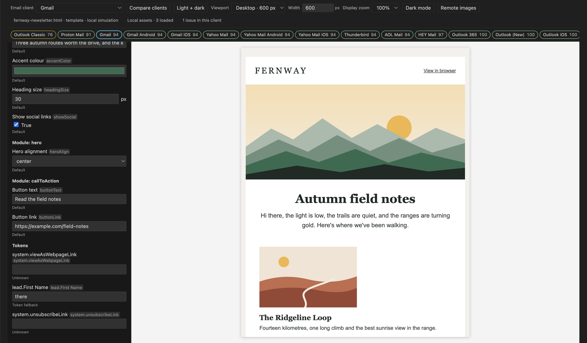
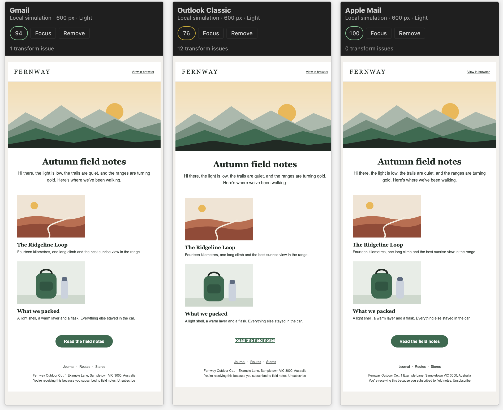
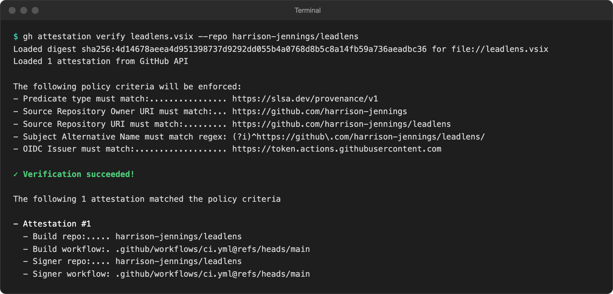
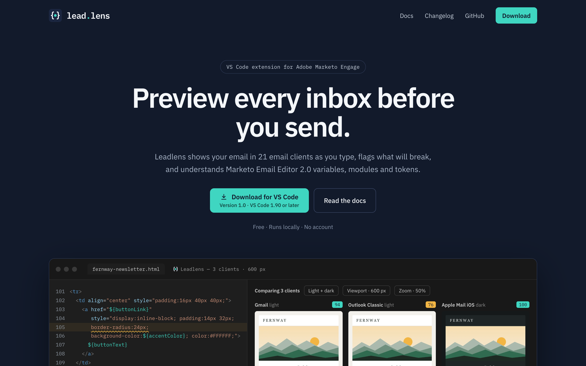
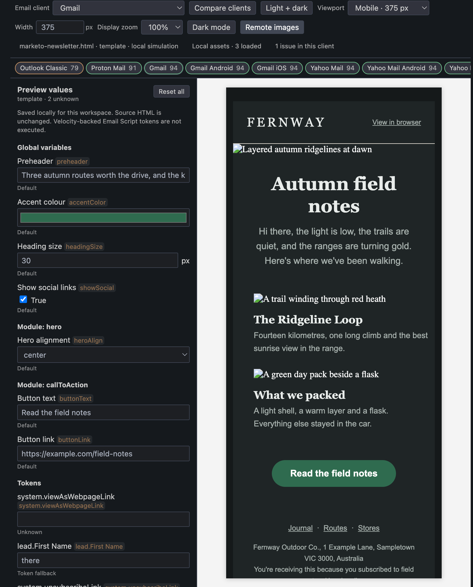

A couple of months ago I wrote about [whether sending yourself a test email is enough](/blog/is-sending-yourself-a-test-email-enough/). That post was about the end of the process: the sample send arrives, and a pipeline gathers the evidence a reviewer needs to approve it.

This one is about the _other_ end. By the time a test send lands in your inbox, the email has already been built, uploaded and approved in Marketo. If the button falls apart in Outlook, or the dark-mode styles do nothing in Gmail, you find out late, fix it in a code editor, ship it back into Marketo, and send yourself another one. Then you squint at it on your phone again.

So I built [Leadlens](https://leadlens.harrisonjennings.au): a VS Code extension that previews Adobe Marketo Engage emails across 21 email clients as you type, and lints them with an understanding of how Marketo actually works. It runs entirely on your own computer, and it's open source.

## what I wanted

Most of my Marketo email work happens in a code editor rather than in Marketo itself. Email Editor 2.0 templates are HTML with Marketo's own conventions layered on top: `mktoString` and `mktoColor` declarations in the head, `${variables}` in the markup, `{{lead.First Name}}` tokens in the copy, modules and editable regions marked up with classes and `mktoName` attributes.

The tooling for writing that HTML is good. The tooling for knowing how it will render is not. Rendering services exist, but they're paid, they work on a finished email, and they live somewhere other than where you're writing it. Generic HTML linters are free and fast, but they don't know what Marketo is. A `${buttonColor}` in a style attribute looks like broken CSS to them, so the useful warnings get buried under false ones.

What I wanted was simple to describe:

- see how the email will look in the clients that matter, while I'm writing it;
- be told what will break, on the line that breaks it, with a reason I can act on;
- have all of that understand Marketo, rather than argue with it;
- send nothing anywhere: no uploads, no accounts, no tracking pixels firing because I opened a preview.

## not starting from scratch

The hard part of email previewing isn't drawing a box with HTML in it. It's knowing what each client does to that HTML: which CSS properties Gmail strips, how Outlook's Word-based rendering engine treats conditional comments and VML, how Apple Mail recolours a design in dark mode. That knowledge changes constantly, and keeping it current is a job in itself.

I didn't want that job. [Emailens](https://github.com/emailens/engine) already does it: an open-source engine, released under the MIT licence, that models 21 email clients and draws its support data from [caniemail.com](https://www.caniemail.com). Leadlens started from Emailens' own VS Code extension and builds on its engine. The client knowledge is theirs. The Marketo layer, the preview interface and everything around them are mine.

The decision that mattered most was how to depend on it. I'm not going to track email client changes myself, so the engine stays an ordinary dependency rather than a copy I'd have to keep merging. It's pinned to an exact version, and when Emailens publishes a new one, a GitHub Actions bot opens a pull request. The full test suite runs against the new engine, and merging it publishes a new build of Leadlens automatically. The upstream project keeps up with the clients; Leadlens inherits that work through one merge button.

## teaching it Marketo

An Email Editor 2.0 template isn't really an email until Marketo fills it in. The preview has to do the same, so Leadlens reads the template the way Marketo does before handing anything to the rendering engine.

It works out what kind of file it's looking at: a full template, a complete email exported from Marketo, or a standalone component of custom HTML destined for an editable region. It reads the variable declarations (String, List, Number, Color, Boolean, HTML and Image) and fills in their defaults, then lets you override any of them in a preview values panel, globally or per module. Tokens with a fallback, like `{{lead.First Name:default=there}}`, preview as their fallback. Tokens that only exist at send time, like `{{system.unsubscribeLink}}`, are left visibly unresolved rather than invented.

A component can be previewed inside the real template it will live in, so a block of custom HTML for an editable region is checked in context rather than as a lonely fragment. And the editor itself learns the template: modules and regions show up in the outline, hovering a variable shows its declaration, Go to Definition jumps to it, and typing `${` offers the variables that are actually declared.

The part I'm happiest with is that findings still point at the right line. By the time the engine sees the email, variables have been substituted and components composed, so its idea of "line 105" isn't yours. Leadlens maps every finding back through those substitutions to the line you wrote. If a `border-radius` inside a templated button breaks Outlook, the squiggle lands under that declaration in your template, not somewhere in a document you can't see.

Quick fixes follow the same rule. They'll correct a single-braced token or add a missing `mktoName`, but they never touch tokens, Outlook conditional comments or VML.

## previews, not screenshots

It's worth being clear about what the previews are. Leadlens doesn't run Outlook or Gmail. It applies what's documented about each client to your HTML: the styles that get stripped, the properties that aren't supported, the way dark mode recolours things. Then it renders the result. That makes it fast enough to update on every keystroke, and private enough to never leave your machine. It also means it's a simulation.

In practice that trade is a good one. Most of what goes wrong in email is well documented; it's just tedious to remember. Seeing the button lose its corners and padding in the Outlook Classic preview while you're still on the line that caused it is worth a lot more than finding out from a test send twenty minutes later. You can compare up to four clients side by side, see light and dark mode next to each other, and switch between phone and desktop widths, and each client gets a rough compatibility score so the worst one is obvious.

But a simulation can't promise a pixel-perfect match with the real thing, and Leadlens doesn't pretend to. For a final check on a high-stakes send, a real rendering farm or a real inbox still earns its place. As with the review pipeline in my last post, this is a layer on top of the existing process, not a replacement for it. It just moves most of the surprises to a point where they're cheap to fix.

## private by default

Email HTML is often written by someone else, and it often carries things you'd rather not trigger. An open-tracking pixel in a template you're reviewing will happily report that you opened it, just because you previewed it.

So Leadlens has no telemetry and no accounts, and it makes no network requests of its own. Remote images are blocked until you explicitly allow them, and when you do, they're requested without a referrer. The email is rendered in a sandboxed frame where its scripts can't run, behind a content security policy that blocks everything else. Local images work, but only from inside your project folder, so a template can't use the preview to read files from elsewhere on your machine.

None of this is unusual for a security-minded tool, but it matters more than usual here. The whole point is to open other people's HTML and look at it closely.

## shipping it

Leadlens isn't on the [Visual Studio Marketplace](https://marketplace.visualstudio.com/VSCode), at least for now. It's distributed the old-fashioned way: a `.vsix` file attached to a GitHub release, installed with **Install from VSIX…** in [VS Code](https://code.visualstudio.com/).

What isn't old-fashioned is how that file gets made. Every change merged into the main branch goes through the same pipeline:

1. type-check the code;
2. run 266 unit tests against the real engine;
3. run 56 integration tests in an actual copy of VS Code, which opens files, waits for diagnostics, applies quick fixes and opens the preview;
4. package the extension, and check it contains only what it should;
5. publish it as the latest release, at an address that never changes.

The version number comes from the build, so every release is newer than the last and installs over it as an update. Each one is also signed with a provenance attestation: a record, verifiable with one GitHub CLI command, that the file was built by that pipeline from that commit and hasn't been altered since. That matters more than usual for something people download from a link rather than install from a store.

## a home for it

An extension that isn't in a store has to explain itself somewhere else, so Leadlens has [its own website](https://leadlens.harrisonjennings.au). It covers what Leadlens does, how to install it, full documentation for every feature, and the changelog.

The site lives in the same repository as the extension, built with [Astro](https://astro.build/) and [Starlight](https://starlight.astro.build/) and hosted on [Vercel](https://vercel.com/home). That matters more than the choice of framework. The documentation and the changelog aren't written twice: the site is built from the same Markdown files that sit next to the code. A pull request that changes how Leadlens behaves updates its documentation in the same change, and the site rebuilds itself when it merges. Even the version number and the minimum VS Code version on the download buttons are read from the extension's own package file, so they can't drift out of date.

It's also built to match the extension's attitude to privacy. Everything, fonts included, is served from the site itself, there are no cookies, and visits are counted with cookie-free analytics and nothing else.

## the bugs that waited for launch day

Every test was green on launch day. Within a couple of hours of installing the public build, I'd found two bugs anyway.

The first was a quiet one. Leadlens lets a project limit which files it checks, with patterns like `emails/**/*.html`. I opened a sample email, asked for a preview and was told to open an email first. The pattern was being compared against the file's full path on disk, `/Users/…/emails/newsletter.html`, which never matched. Only patterns that happened to start with `**/` worked, and those were exactly the ones the tests used.

The second was stranger. The sample newsletter's images showed as broken in every client, while the preview's own status line cheerfully reported "3 loaded". Leadlens had found the files and worked out the right addresses for them. The problem was the sandbox from the previous section. VS Code serves local files to an extension's preview by intercepting requests to a special address, and a fully sandboxed frame is deliberately cut off from that mechanism. The requests went out to the internet instead, looking for an address that doesn't exist. The fix was to have Leadlens read each permitted image itself and embed it directly, which keeps the sandbox exactly as strict as it was.

I tracked both down thanks to Claude. For the image bug, it drove a real copy of VS Code and read the failed requests straight out of the preview, which is how the sandbox turned out to be the culprit.

What the two bugs have in common is that the tests checked the wrong thing. One tested a pattern nobody would actually write. The other confirmed the image address was correct, without checking the image ever arrived. Both now have tests that fail without the fix.

## what I ended up with

Leadlens opens beside any HTML email, template or component in VS Code. It shows the email in 21 clients, in light and dark mode, at phone or desktop width, updating as I type. Problems appear in the editor where they happen, with an explanation on hover and a fix where one is safe. And it understands Marketo well enough to stop shouting about syntax that Marketo was always going to handle.

It stays current without me, too. When Emailens learns something new about a client, Leadlens picks it up the next time I merge a pull request I didn't have to write.

It's open source under the MIT licence. You can download it, read the documentation or browse the code:

[get Leadlens](https://leadlens.harrisonjennings.au) · [view on GitHub](https://github.com/harrison-jennings/leadlens)

## what I learned

**The domain knowledge is the product.** Rendering email is a solved problem, and someone else solves it better than I would. What was missing was the Marketo layer: knowing what a `${variable}` is, what a token fallback does, where a module ends. That's where my time went, and it's the part nobody else was going to build.

**Depend on the people doing the hard part, and make it cheap to keep up.** A copy of someone else's engine starts going stale the day you take it. A pinned dependency, a bot and a good test suite turn staying current into a five-second decision.

**Be honest about what a tool can't do.** A simulation that claims to be a screenshot is worse than no preview at all, because people stop checking. Saying clearly what Leadlens does and doesn't promise is what makes the rest of it trustworthy.

**Test what the person sees, not what the code believes.** Both launch-day bugs passed every test, because the tests asked the code whether it had done its job, and the code said yes.

In my other post, the principle was to automate evidence, not judgement. Leadlens is the same idea, earlier in the process. It shows you what each inbox will _probably_ do with your email, while you can still change it. Deciding what to do about that is still your call.
