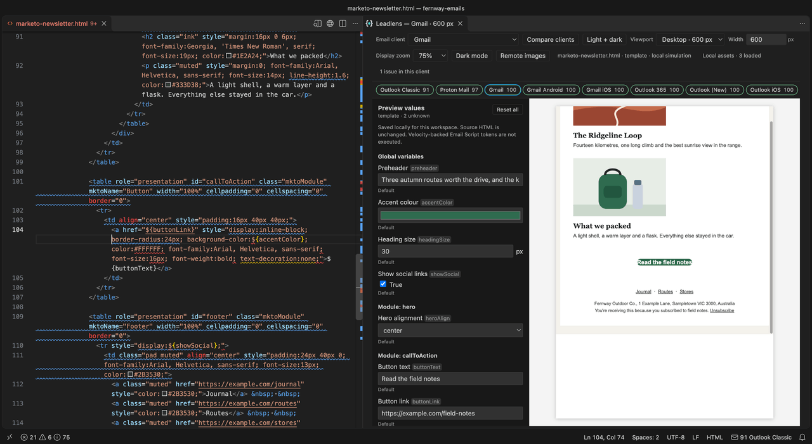

Earlier this month I wrote about [building Leadlens](/blog/leadlens-email-previews-and-linting-for-marketo-inside-vs-code/), a VS Code extension that previews Adobe Marketo Engage emails across 21 email clients as you type, and lints them with an understanding of how Marketo actually works. Back then, installing it meant downloading a file from GitHub. As of today, it's on the [Visual Studio Marketplace](https://marketplace.visualstudio.com/items?itemName=leadlens.leadlens).

Add `padding` to a templated button and Leadlens warns that Outlook Classic drops it, explains why on hover, shows the button collapsing in the Outlook Classic preview, and offers a quick fix.

## what changes

**Installing is one click.** Search for Leadlens in VS Code's Extensions view, or open [its Marketplace listing](https://marketplace.visualstudio.com/items?itemName=leadlens.leadlens) and choose **Install**. No more downloading a `.vsix` and hunting for the install button in VS Code.

**It keeps itself up to date.** Leadlens gets its knowledge of email clients from the open-source [Emailens](https://github.com/emailens/engine) engine. When Emailens learns something new about how Gmail or Outlook treats your HTML, a new build of Leadlens goes to the Marketplace, and VS Code installs it like any other extension update. Your previews and warnings get more accurate without you doing anything.

**It works beyond VS Code.** Leadlens is also on [Open VSX](https://open-vsx.org/extension/leadlens/leadlens), the registry Cursor, VSCodium and Windsurf install extensions from, so it's a search away in those editors too.

## try it

It's free, it runs entirely on your own computer, and it's open source under the MIT licence.

[install from the VS Code Marketplace](https://marketplace.visualstudio.com/items?itemName=leadlens.leadlens) · [visit the Leadlens website](https://leadlens.harrisonjennings.au) · [read the full story](/blog/leadlens-email-previews-and-linting-for-marketo-inside-vs-code/)
