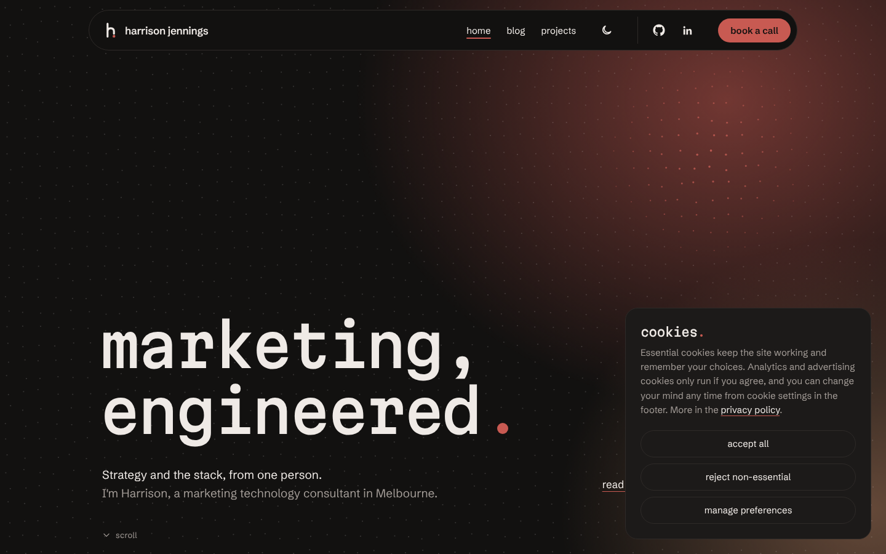
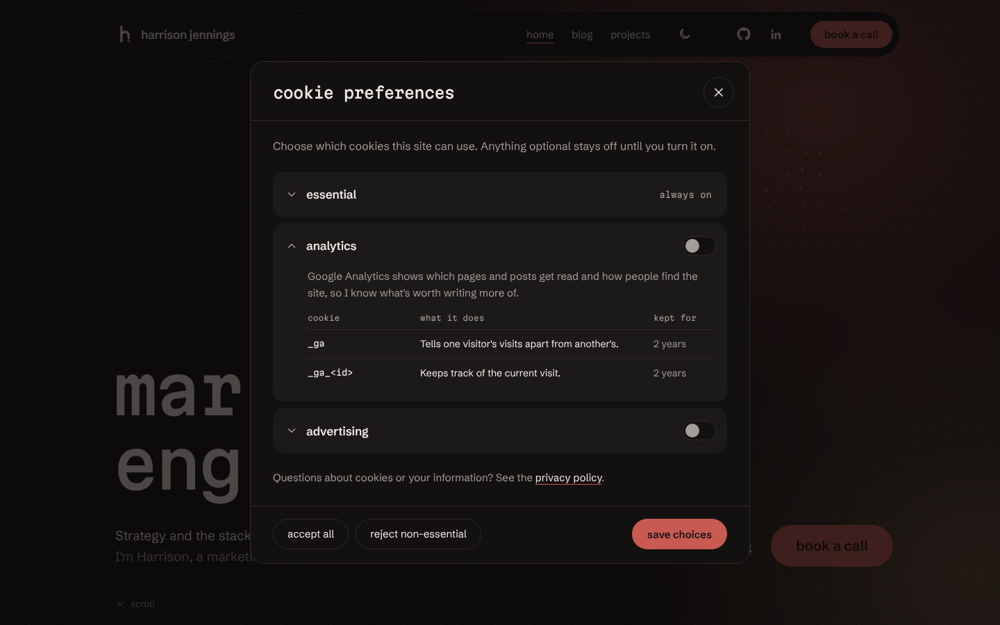

Until this month, every visit to this site started a small chain of work: a server ran PHP, PHP queried a MySQL database, and a dozen plugins I hadn't written each got a say, all to show you a page that rarely changed.

Now, loading a page here runs nothing at all. Every page is a file, built in advance and served from Cloudflare's edge network, from a data centre close to wherever you're reading.

Getting there was more than just a hosting change. I rebuilt the site the way I'd want a client's production system built: designed before it was coded, tested before it shipped, and private and secure by default. The design system, the consent model, the security policy and the delivery pipeline are all in a [public GitHub repository](https://github.com/harrison-jennings/harrisonjennings.au), and this post is a tour of the parts I enjoy the most.

## why move at all?

WordPress served this site well. The writing was there, the projects were there, and it introduced me perfectly adequately. But it also felt like a stock-standard WordPress theme I just happened to occupy. That was awkward for a website whose entire job was to represent my work.

By the end it was costing me about $250 a year in hosting to run a PHP application and a MySQL database so that a handful of pages and blog posts could be shown to people.

Every page view ran code. Every plugin was a dependency I didn't choose and couldn't really control. The consent banner, the SEO metadata and the caching were each a separate plugin with its own settings screen, its own update cadence, its own vulnerabilities, and its own opinions. And the content lived in a database I only ever touched through a web editor, when everything else I write lives in [VS Code](https://code.visualstudio.com/).

None of that is a disaster. It's just not how I'd build it if I were starting today.

So I wrote down what starting today would look like:

- **Every page is a file.** No server, no database and no code running behind a page view.
- **One source of truth for the brand.** Colours, type and spacing defined once, and used everywhere from the CSS to the social share images.
- **Content as code.** Posts in Markdown, in the repository, checked at build time like any other code.
- **Consent before measurement,** with my own record of every choice rather than a plugin's.
- **Nothing reaches production without passing checks,** and every deploy proves it works before it matters.
- **Keep every URL Google already knew.** A migration that loses its search history isn't a migration, it's a relaunch.
- **Essentially free to run.**

## the shape of it


The site is built with [Astro](https://astro.build/), which turns Markdown and components into plain HTML at build time, and is served from [Cloudflare Workers static assets](https://developers.cloudflare.com/workers/static-assets/).

| layer       | chosen                                  | why it won                                                                                           |
| ----------- | --------------------------------------- | ---------------------------------------------------------------------------------------------------- |
| framework   | Astro, static output                    | HTML by default and JavaScript only where I ask for it; typed content collections                    |
| hosting     | Cloudflare Workers static assets        | Free for commercial use, a preview per branch, and my DNS was already there                          |
| data        | Cloudflare D1                           | Cloudflare's SQLite database                                                                         |
| content     | Markdown in the repository              | Reviewed, versioned and validated like code                                                          |
| consent     | CookieConsent v3, with my own interface | It keeps the state; I own the design and the record                                                  |
| measurement | Server-side Tag Manager on Cloud Run    | Already built: [the story is here](/blog/when-your-website-gets-attacked-before-anyone-even-visits/) |

There's exactly one piece of server-side code in the whole site: a small Worker that answers two endpoints under `/api/` and runs one scheduled clean-up a day. Everything else is a static file. A page view never executes anything of mine.

There's also no client-side framework. The interactive parts – the hero banner's particle field, the lightbox image viewer, the project switcher, the testimonial ticker – are small TypeScript modules, each loaded only on the pages that use it.

:::tip
"Static" doesn't mean "basic". It means every interesting decision happens at build time, where it can be tested, instead of at request time, where it can fail in front of someone.
:::

## a brand that lives in one file

Before any page was built, the site was designed: a brand identity, a logo with its own motion treatment, a type pairing, a colour palette that works in both dark and light mode, and then every page, mocked up at desktop and phone widths and signed off one by one.


The part that matters for engineering is where that design ended up: a single file, `design/tokens.json`, that holds every colour (in both themes), every spacing step, radius and type style.

Each token carries more than a value. Here's the brand's accent colour:

```json title="design/tokens.json"
{
  "name": "accent",
  "value": { "dark": "#c85a52", "light": "#a8443d" },
  "usage": "Brick. The logo's dot, button fills, link underlines, […]"
}
```

The `usage` note is the design decision written down next to the value it governs: where the colour may be used, and the contrast ratios that decide where it can't. When I come back in a year wondering why a link on a card isn't brick, the answer is in the file, not in my memory.

Nothing else in the codebase is allowed to invent a colour. A build script turns the tokens into CSS custom properties, with dark as the default and light applied only when someone picks it with the theme toggle. And because the tokens are data rather than a stylesheet, other things can read them too:

```ts title="src/lib/og/card.ts"
import tokens from '../../../design/tokens.json';

const dark = (name: string): string => {
  const token = tokens.color.tokens.find((t) => t.name === name);
  if (!token) throw new Error(`design/tokens.json: no colour token "${name}"`);
  return token.value.dark;
};
```

That's part of the social share-card generator asking the brand for its colours. The architecture diagram above is drawn the same way, as is the screenshot at the top of the README. Change the brick red in one file, rebuild, and the site, every share image, and the documentation all change with it.

Note the `throw`, too. A typo in a token name doesn't quietly fall back to black: it fails the build. That idea – turn a silent mistake into a loud one, as early as possible – runs through the whole project.

## content as code

Posts are Markdown files in the repository, each in its own folder with its images beside it. There's no CMS to host, patch or log into.

What makes that workable is that the content has a schema. Every post's front matter is validated at build time, so a description that's too long for a dek and card excerpt, a topic that doesn't exist, or a date that isn't a date fails the build rather than the page:

```ts title="src/content.config.ts"
schema: ({ image }) =>
  z.object({
    title: z.string(),
    description: z.string().max(180),
    searchTitle: z.string().max(65).optional(),
    published: z.coerce.date(),
    topics: z.array(reference('topics')).default([]),
    cover: image().optional(),
    related: z.array(reference('posts')).max(3).optional(),
    // …
  }),
```

`reference('topics')` and `reference('posts')` mean a post can only point at things that exist. Rename a topic and forget a post that uses it, and the build tells you which one.

The Markdown pipeline does more than render text. A handful of small transforms, each with its own unit tests, handle the things I'd otherwise do by hand and get wrong:

- **Reading time** is calculated from the prose at build (code blocks don't count, since _nobody_ reads a JSON payload at 230 words a minute).
- **Callouts, figures and footnotes** come from plain Markdown syntax, so writing content never means hand-writing HTML.
- **Code blocks** are highlighted at build by [Shiki](https://shiki.style/), coloured from the same tokens, with file names, highlighted lines and a copy button. Shell prompts are dimmed and left out of what gets copied.
- **Every image** gets responsive sizes, and opens in a zoomable viewer that only loads the full-size file when it's actually opened.

And because a lot of what I write is about [Adobe Marketo Engage](https://business.adobe.com/au/products/marketo.html), my site ships its own syntax grammar for [Velocity](https://velocity.apache.org/), the Java-based templating language Marketo uses for email scripting. Shiki doesn't ship a Velocity grammar, so I taught it one:

```vtl
## Subscription custom object: every plan renewing in the next 30 days
#set( $renewing = [] )
#foreach( $sub in $sorter.sort($subscription_cList, "renewalDate:asc") )
  #set( $renewal = $convert.parseDate($sub.renewalDate, "yyyy-MM-dd") )
  #set( $days = $date.difference($date.date, $renewal).getDays() )
  #if( $days >= 0 && $days <= 30 )
    #set( $void = $renewing.add("${sub.planName} renews in $days days") )
  #end
#end
#if( $renewing.isEmpty() )
Nothing is due for renewal this month.
#else
#foreach( $line in $renewing )
$line<br>
#end
#end
```

## pictures that draw themselves

When a page from this site is shared on LinkedIn or Slack, the preview image is a card made specifically for that page, with its title, topic and date.

I don't make those cards. The build itself does.

At build time, [Satori](https://github.com/vercel/satori) lays out each card from the page's own content, in the brand's fonts and token colours, and [sharp](https://sharp.pixelplumbing.com/) renders it to a 1200 × 630 PNG. Every page with its own card gets one; anything else falls back to the home page's.

```ts title="src/lib/og/render.ts"
export async function renderCard(card: Card): Promise<Buffer> {
  const svg = await satori(cardElement(card) as unknown as Parameters<typeof satori>[0], {
    width: WIDTH,
    height: HEIGHT,
    fonts: await loadFonts(),
  });
  // The clouds go underneath as plain SVG gradients (Satori can't size an elliptical gradient).
  const full = `<svg xmlns="http://www.w3.org/2000/svg" width="${WIDTH}" height="${HEIGHT}">${cloudsSvg(card)}${svg}</svg>`;
  return sharp(Buffer.from(full)).png({ compressionLevel: 9 }).toBuffer();
}
```

The practical win is that share images can never go stale. Retitle a post, and its card changes with the next deploy. The less obvious win is that they're always on brand, because there's no other way for them to be made.

## consent as a system, not a plugin

This is the part I'd most like people in my line of work to read, because consent is usually where a site's engineering quietly falls apart.

The typical setup is a consent plugin or CMP, a Tag Manager template that reads it, and a cookie list in the privacy policy that someone wrote once and never updated. Three things, maintained separately, which drift apart the moment anyone adds a tag.

Here, consent is one system, with one source of truth.

<Figures cols={2} caption="The banner on a first visit, and the preferences behind it. 'accept all' and 'reject non-essential' carry equal visual weight, and nothing optional runs until you choose.">
   
</Figures>

### one cookie list, used everywhere

Every cookie the site can set lives in one YAML file, with its category, domain, purpose and lifetime:

```yaml title="src/content/consent.yaml"
- id: analytics
  name: analytics
  description: Google Analytics shows which pages and posts get read and how people find the site, so I know what's worth writing more of.
  cookies:
    - name: _ga
      domain: .harrisonjennings.au
      purpose: Tells one visitor's visits apart from another's.
      kept: 2 years
```

The cookie preferences dialog reads that file. So does the privacy policy, which doesn't contain a single hard-coded cookie table. Instead, it has a one-line directive where each generated table goes:

```md title="src/content/pages/privacy-policy.md"
::cookie-table{category="analytics"}
```

At build, a small [remark](https://github.com/remarkjs/remark) transform swaps each directive for a table generated from the same YAML. The banner and the policy can't disagree, because there's only one list for them to read. And a category which the policy names but the YAML doesn't have won't render a broken table; it will fail the build.

### consent before anything loads

[Google's Advanced Consent Mode v2](https://developers.google.com/tag-platform/security/guides/consent?consentmode=advanced) is set by the site itself, in the page `<head>`, before Tag Manager loads: every optional signal starts as denied, and a returning visitor's saved choice is applied straight away, so their first page view isn't measured as if they'd refused.

That logic lives in the site's code, not in a Tag Manager template, so it's covered by the same tests as everything else. The end-to-end suite checks that a first visit starts with everything optional denied, no cookies are set and nothing optional runs before a choice is made, and that each choice is applied, logged and remembered.

### my own record of every choice

When someone makes a choice, or changes it, the site records it in a consent log: a [Cloudflare D1](https://www.cloudflare.com/products/d1/) table behind the site's one Worker. Each row says what was agreed to, when, on which page, and against which version of the banner. Rows are never updated, so the history of a person's choices is kept.

The visitor's IP address is never stored. The Worker keeps a keyed hash of it instead:

```ts title="src/worker/consent.ts"
/** HMAC-SHA256 of the IP with the secret key, as hex. */
export async function hashIp(ip: string, key: string): Promise<string> {
  const encoder = new TextEncoder();
  const cryptoKey = await crypto.subtle.importKey(
    'raw',
    encoder.encode(key),
    { name: 'HMAC', hash: 'SHA-256' },
    false,
    ['sign'],
  );
  const signature = await crypto.subtle.sign('HMAC', cryptoKey, encoder.encode(ip));
  return [...new Uint8Array(signature)].map((b) => b.toString(16).padStart(2, '0')).join('');
}
```

A keyed hash can be matched against an IP address someone gives me ("what did I agree to?") but can't be turned back into one, and without the secret it can't be brute-forced across the IPv4 space either.

Every record is also checked for coherence before it's written, not just for shape. A record has to match the current banner revision, always include the essential category, include every category for "accept all" and only the essential one for "reject". Anyone can post to a public endpoint; this makes sure that anything the banner couldn't have produced is turned away.

```ts title="src/lib/consent.ts"
if (revision !== CONSENT_REVISION) return null;
// …each field's shape is checked here…
const accepted = CATEGORIES.filter((c) => categories.includes(c));
if (!accepted.includes('necessary')) return null;
if (action === 'accept_all' && accepted.length !== CATEGORIES.length) return null;
if (action === 'reject_all' && accepted.length !== 1) return null;
```

Records are kept for 12 months, then purged automatically by a scheduled cron job on the same Worker. The privacy policy states that period, and the retention code carries a comment saying the two change together.

:::note
Branch previews log to their own, separate D1 database instance, with no IP key at all. Testing a cookie banner shouldn't put rows in the production consent log.
:::

## a security policy the build writes for itself

A Content-Security-Policy (CSP) tells the browser exactly where a page is allowed to load scripts, styles, images and frames from. It's one of the most effective defences a website has against injected scripts, and one of the least commonly deployed, because a real one is fiddly to maintain.

The fiddly part is inline scripts. A strict policy refuses them unless each one is listed by its hash. On a server-rendered site you'd use a per-request nonce instead, but a static site has no request to attach one to.

So the build does it. After Astro writes the finished pages, a small integration reads every HTML file, finds every inline script that would actually execute, hashes it, and writes the policy into the `_headers` file that Cloudflare serves:

```ts title="src/lib/csp-build.ts"
'astro:build:done': async ({ dir, logger }) => {
  const out = fileURLToPath(dir);
  const hashes = new Set<string>();
  for (const file of await htmlFiles(out)) {
    const html = await readFile(file, 'utf8');
    const handlers = inlineHandlers(html);
    if (handlers.length)
      throw new Error(`CSP: inline event handlers (${handlers.join(', ')}) in ${file}`);
    for (const script of inlineScripts(html)) hashes.add(scriptHash(script));
  }
  // …writes the policy into dist/_headers
},
```

Two details make this hold together.

First, the inline scripts are the same on every page. Page-specific values, like the title and type that go into the analytics data layer, are written into a JSON block, which browsers never execute, and the shared script reads them from there. So the whole site needs exactly three script hashes, and they only change when the scripts themselves do.

Second, component scripts are never inlined. Astro would normally inline small scripts to save a request; here it's configured not to, so they're files on the site's own origin and need no hash at all.

The policy is currently in report-only mode. Browsers report every violation to a second Worker API endpoint, which counts them in Cloudflare D1, one row per distinct violation, so I can see exactly what Tag Manager loads on real visits before the policy starts blocking anything. Shipping a CSP in enforcing mode on day one is a good way to break your own analytics and not find out for a week.

Around that sit the less glamorous protections:

- strict transport security, `nosniff`, a frame-deny policy, and a permissions policy that turns off the camera, microphone, location and payment APIs
- a byte cap on every request body the Worker reads
- parameterised SQL only
- a Cloudflare rate-limiting rule in front of `/api/*`, so a flood is stopped before any code runs at all

## orchestrating CI/CD

Nothing reaches `main` without a pull request, and no pull request merges without passing checks. Those checks run as two orchestrator workflows, each calling a set of small reusable ones.

```yaml title=".github/workflows/ci-orchestrator.yml"
name: 🛠️ CI Orchestrator

# Is this change safe to merge? Every check, in one run, on each pull request and on main.
# (Names, permissions and conditions trimmed for this post.)
jobs:
  quality:
    uses: ./.github/workflows/quality.yml
  end-to-end:
    uses: ./.github/workflows/end-to-end.yml
  lighthouse:
    uses: ./.github/workflows/lighthouse.yml
  codeql:
    uses: ./.github/workflows/codeql.yml
  dependency-review:
    uses: ./.github/workflows/dependency-review.yml
```

Each check exists to protect something specific:

| check             | what it runs                                                           | what it protects & enforces                                                                 |
| ----------------- | ---------------------------------------------------------------------- | ------------------------------------------------------------------------------------------- |
| quality           | Prettier, ESLint, strictest TypeScript, Vitest, the production build   | Code that's consistent, typed and correct, and a site that builds                           |
| end-to-end        | Playwright against the built site, served the way Cloudflare serves it | Pages, redirects, headers, consent behaviour, structured data, and accessibility (axe)      |
| lighthouse        | Lighthouse CI, three runs on four key pages                            | 95 or better on performance, accessibility, best practices and SEO, or the merge is blocked |
| CodeQL            | GitHub's static analysis                                               | Security flaws in the code itself                                                           |
| dependency review | GitHub's review of any new or changed package                          | Stops known-vulnerable dependencies arriving in a pull request                              |

The CI Orchestrator answers one question: is this change safe to merge?

The CD Orchestrator answers a different one: did the deploy actually work? Cloudflare builds and deploys every push itself (`main` to the production environment, every other branch to a private preview behind Cloudflare Access), so the CD side never deploys anything. It watches. After each merge, it waits for Cloudflare's deploy of that exact commit, then smoke-tests that exact version – pages, an old WordPress redirect, the 404, the security headers, the feeds and the Worker – before recording it as a production deployment in GitHub.

```yaml title=".github/workflows/cd-orchestrator.yml" {17-18}
name: 🚀 CD Orchestrator

# Did the deploy work? Cloudflare deploys every push; this watches those deploys and
# never deploys anything itself.
# (Names, permissions and fork checks trimmed for this post.)
jobs:
  preview-link:
    if: github.event_name == 'pull_request'
    uses: ./.github/workflows/preview-link.yml
  preview:
    if: github.event_name == 'pull_request'
    uses: ./.github/workflows/preview-deployment.yml
  deployed-version:
    if: github.event_name != 'pull_request'
    uses: ./.github/workflows/production-version.yml
  production:
    needs: deployed-version
    if: vars.PRODUCTION_LIVE == 'true'
    uses: ./.github/workflows/production-live.yml
```

The highlighted lines are the important ones: a deploy is only recorded as a production deployment once that exact version has passed its smoke test.

:::note
A smoke test from GitHub's runners against the live domain gets challenged by Cloudflare's Bot Fight Mode, which is doing exactly its job. So the CD Orchestrator tests each version through its own preview address instead, authenticating to Cloudflare Access with a service token. The bot protection stays on, and the test checks the exact version that went live.
:::

### the supply chain is part of the system

A pipeline is only as trustworthy as what it runs. So:

- **Every GitHub Action is pinned to a full commit SHA,** not a tag, because a tag can be moved and a SHA can't. The repository settings require it.
- **Only GitHub's own actions are allowed to run.** Third-party actions are one of the most common supply-chain attack routes, and this repository doesn't need any.
- **Every workflow declares least-privilege permissions,** read-only by default and widened only for the job that needs it, and checkouts don't keep credentials afterwards.
- **Untrusted input is passed as data, never pasted into a script.** A branch name can contain anything.
- **Dependabot groups minor and patch updates** weekly, and gives every major update its own pull request, so one breaking release can't hold the rest hostage.
- **`main` is protected by a ruleset:** pull requests only, squash merges, linear history, no force pushes, and the three required checks pinned to GitHub Actions as their source, so nothing else can satisfy a check by sharing its name.

## moving house without losing the address

The bit of a migration nobody sees, when it's done well, is SEO.

Every post moved from WordPress's date-based URLs to a simpler `/blog/<slug>/`, and every old address has an explicit 301 to its new home. No wildcards, no chains. Old `category` pages redirect to their new `topic` pages, the old feed redirects to the new one, and migrated posts keep their WordPress IDs in the RSS feed, so existing subscribers don't see old posts arrive as new.

None of that is taken on trust. A crawl test holds every URL the WordPress site ever published or Google ever knew about, and checks each one on every pull request:

```ts title="tests/e2e/crawl.spec.ts"
for (const path of urls.kept) {
  test(`${path} answers 200, or 301s once to a page that does`, async ({ request, baseURL }) => {
    const first = await request.get(path, { maxRedirects: 0 });
    if (first.status() === 200) return;
    expect(first.status(), `${path} should answer 200 or 301`).toBe(301);
    const target = new URL(first.headers()['location']!, baseURL);
    const second = await request.get(target.pathname, { maxRedirects: 0 });
    expect(
      second.status(),
      `${path} → ${target.pathname} should answer 200, not redirect again`,
    ).toBe(200);
  });
}
```

The addresses that only ever made sense on WordPress, like `/wp-admin/`, `/wp-login.php` and `/xmlrpc.php`, are checked too: they have to answer a real 404, not a soft one. Old `?p=` shortlinks are the one exception: a static site ignores the query string, so they land on the home page.

Parity was the floor, not the goal. Most of the posts on the old site were sitting in Search Console as "crawled or discovered, currently not indexed" (because I lazily never bothered to fix the SEO), so the new site goes further: structured data on every page, sitemap dates only where there's a real date behind them, and search titles written for what people actually search, kept separate from the headline I want readers to see.

## the repository is the site

Here's a property I didn't fully appreciate until it was built: everything that makes up the website lives in one Git repository. The design tokens, every component, every post and image, the privacy policy, the cookie list, the redirects, the security headers, the database schema and the Worker. The site you're reading right now is a deterministic build of one commit.

That changes what "backup" means. There's no database export to schedule and no hosting snapshot to restore. Every version of the site that has ever existed can be rebuilt from its commit, and the history explains why each change was made, because every change arrived as a reviewed pull request with a description. Rolling back is as simple as redeploying an earlier version.

:::warning
Honesty matters more than a tidy story here, so: Git holds the site, not everything around it. The consent log lives in D1, Cloudflare's own settings (DNS, Access, the rate limit, bot protection) live in Cloudflare, secrets live in Cloudflare and GitHub, and the Tag Manager containers live in Google. The repository documents all of them and can rebuild the site from nothing, but those few pieces of state are backed up where they live.
:::

## why the repository is public

When the migration was done, I made the repository public. A few reasons.

**It's one of the most honest portfolio pieces I have.** I can write about how I think systems should be built, or I can show one, with its tests, its trade-offs and its history. The second is a lot more convincing.

**Public code keeps me honest.** Parts of this site were built with help from [Claude Code](https://claude.com/product/claude-code), and when AI has helped write something, the best answer to "is it any good?" is to let people read it. Publishing it means the code can be judged on what's actually there. It's also a useful pressure in its own right: no "temporary" hacks, no secrets in config files, no comments I'd be embarrassed by. The repository was built to that standard from the first commit, which made publishing it a settings change rather than a clean-up project.

**It's useful to someone else.** A static site with a real consent log, a build-written CSP, generated share cards and a tested migration is a pattern other people can lift. The code is MIT licensed and the writing is CC BY 4.0, so they can.

**Public makes it more secure, not less.** Making it public turned on GitHub's CodeQL scanning and dependency review for free, along with enabling private vulnerability reporting, and there's a [security policy](https://github.com/harrison-jennings/harrisonjennings.au/blob/main/SECURITY.md) explaining how to use it. A static site whose security doesn't depend on its source being secret is the only kind worth publishing in my view, and not something I would've been at all comfortable doing with my WordPress build.

## by the numbers

|                                               |     |
| --------------------------------------------- | --: |
| client-side frameworks                        |   0 |
| lines of server-side code                     | 172 |
| Worker endpoints                              |   2 |
| inline scripts allowed by the CSP             |   3 |
| checks required to merge                      |   3 |
| minimum Lighthouse score to merge             |  95 |
| automated tests (unit and end-to-end)         | 384 |
| WordPress URLs checked on every pull request  |  34 |
| explicit 301 redirects (no wildcards)         |  25 |
| design system tokens, in one file             |  65 |
| hosting cost per year (WordPress: about $250) |  $0 |

## was this overkill?

Does a personal website with some blog posts and projects need a full design system, a consent log, a security policy that writes itself and two CI/CD orchestrators?

No.

Would I build a client's website any other way?

Also no.

And that's really the point. If I'm going to tell people how marketing systems should be built, the one with my name on it should be able to stand up to the same scrutiny.

The site itself costs nothing to host, runs nothing when you visit, and checks its own work before anything goes live.

The security turned out well enough that the first thing it locked out was my own deployment pipeline, which I'm choosing to take as a compliment.

The old hosting was due to renew on 11 November.

It won't be.
