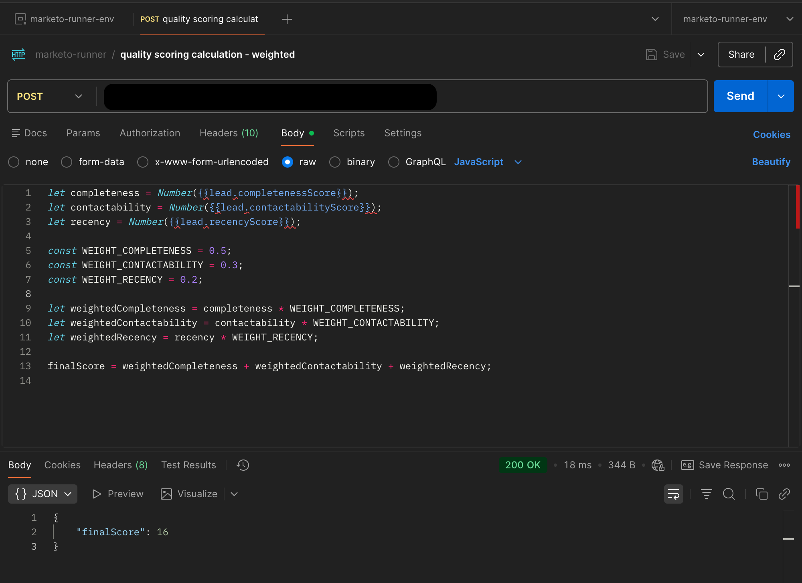
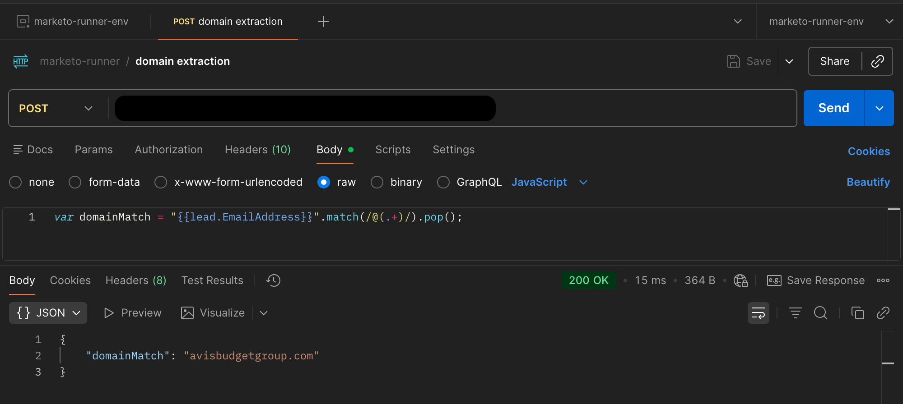
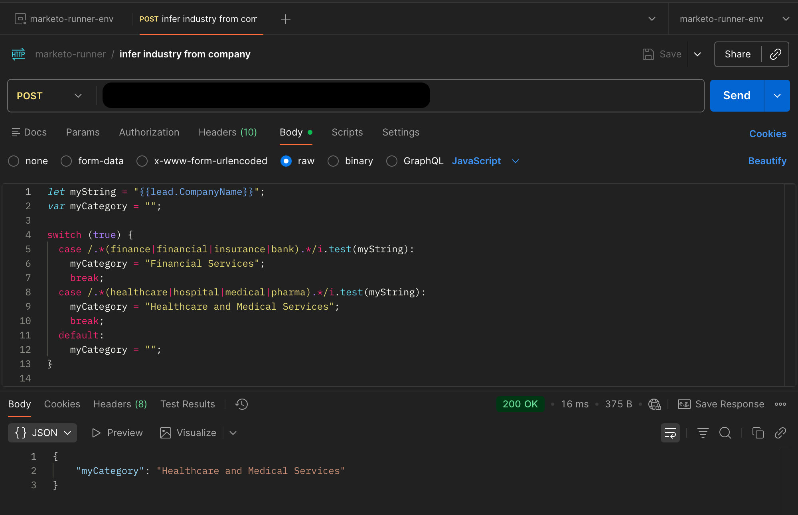
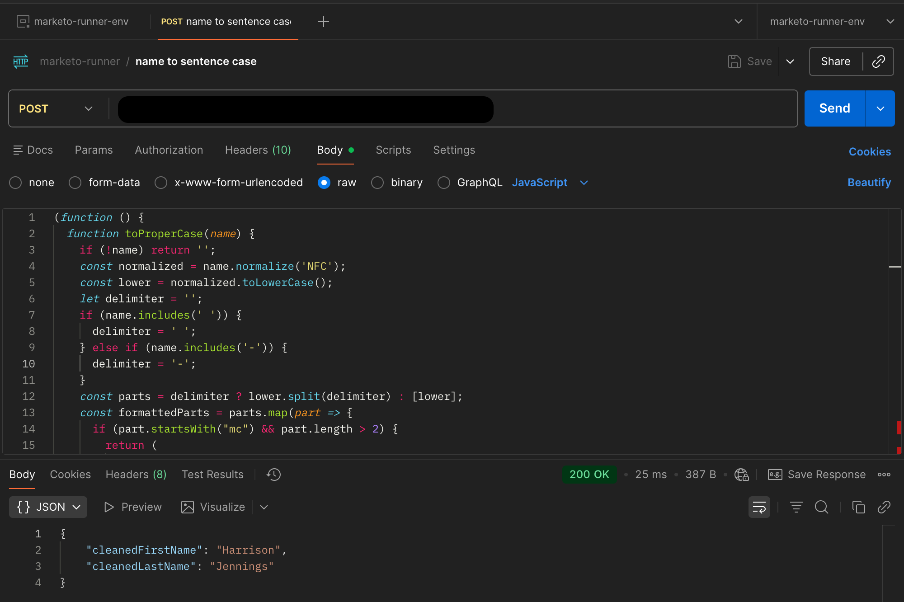
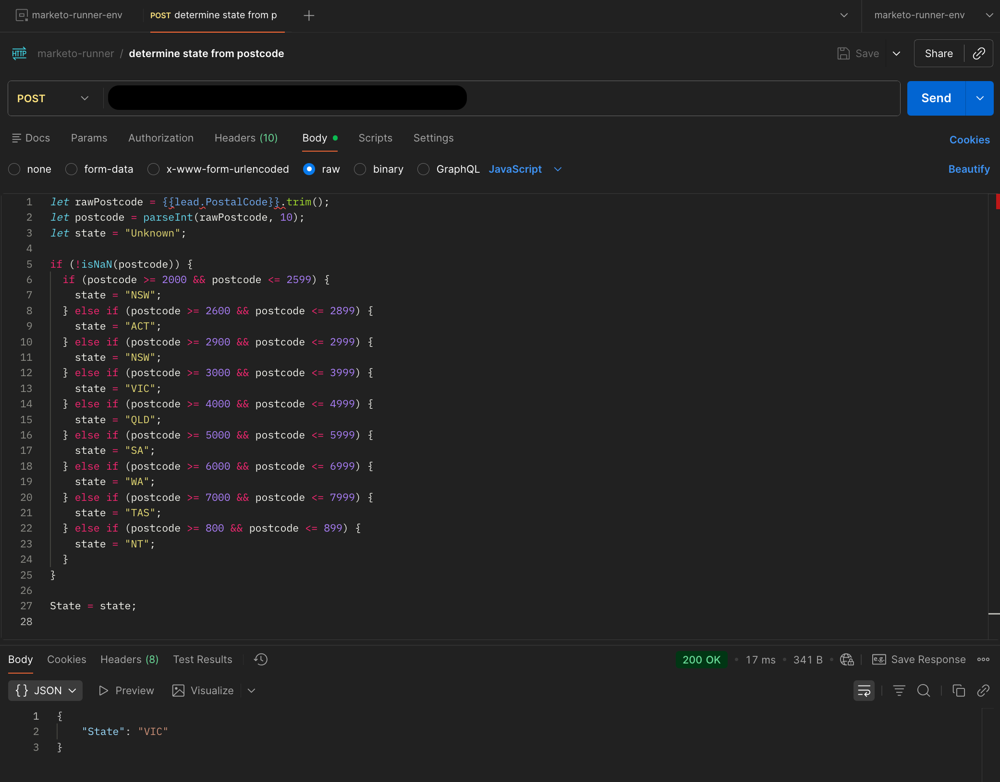
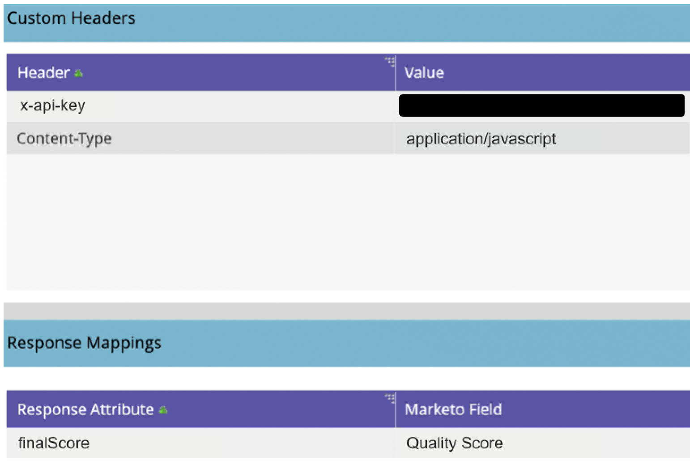

If you’ve spent any time pushing Marketo beyond its comfort zone, you’ll know the name **Sanford Whiteman**. Sanford's work - especially [FlowBoost](https://flowboo.st/) - has shaped what’s possible in the platform for years. FlowBoost is widely used, deeply respected, and frankly one of the most elegant solutions ever created for extending Marketo’s native flow logic.

This post exists because of his work, not in spite of it.

[FlowBoost](https://flowboo.st/) solved a problem that every advanced Marketo user eventually runs into: sometimes a Smart Campaign simply isn’t smart enough. When you need real logic - advanced scoring calculations, data transformations, value extraction, conditional branching - Marketo’s out-of-the-box flow steps hit their limits quickly. FlowBoost stepped into that space brilliantly, allowing users to execute JavaScript from within a Marketo flow action via a webhook call, and even make return calls to the Marketo REST API (or any API, for that matter) to process any actions outside of your flow steps.

## what did I need to do?

In my case, I needed that same power - but I also needed something else: **full ownership of the infrastructure processing customer data.** Our legal team required that all customer data-handling services run inside our owned data environments, under our own controls, with no external dependencies. That meant that as much as I admired FlowBoost (and I really, really do), I couldn’t use it in our production environment.

So rather than reinvent Sanford’s work wholesale (which would be equal parts unnecessary and impossible), I set out to build a **lightweight, purpose-built version** that satisfied our compliance requirements while solving our specific use cases. Essentially, a private, internal cousin of FlowBoost: a secure JavaScript execution engine running in Google Cloud, designed to slot neatly into Marketo via webhooks and extend flow-step logic with dynamic computation.

What follows is a walk-through of what I built, why I built it, and how it fits into Marketo’s wider ecosystem of tools. But make no mistake: this approach stands firmly on the brilliant foundation Sanford created. My contribution was less about invention and more about adaptation - building something that honoured the original idea while operating within the strict regulatory boundaries of my environment.

## why did I need this at all?

The original task was relatively simple (to begin with) - I wanted to extend Marketo's flow step logic to handle advanced scoring calculations. Think things like using data on the lead record to calculate advanced scoring using weighted values - crazy stuff. Marketo's native flow logic is powerful but limited, especially when it comes to multi-step calculations or dynamically transforming data. Rather than build rigid solutions or rely on manual workarounds, I wanted a service that could be managed and controlled from within the Marketo UI, in a sense enabling Marketo users to self-serve.

### other use cases

But I wasn't just going to build this elaborate solution for one scoring calculation (well, I was...), so I had to justify to myself that this infrastructure would be useful in other cases, too. So, I pulled up my mental list of things that were annoying me about this particular Marketo instance and got to work - below are just a few of the things I came up with (click to expand).

<details>
<summary>Advanced scoring logic</summary>

I mentioned this above, but I had a need to run some advanced scoring on our database in response to an internal focus on database quality. I wanted to use field values on the lead record to calculate a recency score, a completeness score, and an orderliness score. Sure, each of these scores tells a story on their own, but imagine combining these with existing behavioural and demographic scoring frameworks in an advanced weighting calculation to create an overall 'combined' score.

</details>

<details>
<summary>Name to sentence case</summary>

One of our internal systems which pushes leads to our Marketo instance always stored first and last name values in all capital letters, which is fine for anything except for a customer engagement platform. Imagine if there was a way to trigger a campaign upon new people being created from this source which would normalise their first and last names to sentence case.

</details>

<details>
<summary>Domain extraction</summary>

A simple one, but this business had both a B2C and a (smaller) B2B component, so being able to identify the company's website domain from their email address would save some time when building out target accounts.

</details>

<details>
<summary>Infer industry from company</summary>

In a similar fashion to the domain extraction task, when it comes to maintaining segmentation of target accounts and account groups, being able to natively categorise accounts into their industry directly within Marketo is a no-brainer.

</details>

<details>
<summary>Determine state from postcode</summary>

This was a long-standing frustration for me - postcode was a very important value for us. In Australia, we have 6 states and 2 territories, each with their own state-based government, laws, and administration. As such, it is often the case that fees, taxes, and duties are set at a state level, impacting dynamic pricing calculations. Thankfully, you can easily tell which state/territory someone belongs to from their postcode. We do collect state in some forms, but we collect postcode in all of them. So the ability to determine state from postcode would save time, improve segmentation velocity, and remove a fiddly bottleneck.

</details>

<details>
<summary>Create 'friendly' product name</summary>

We attribute product interest via several lead acquisition channels, and to facilitate downstream APIs and other automations, the product interest fields store values as "[Product Code] - [Product Name]". This is a mandatory requirement of a core downstream lead distribution system, but obviously not ideal to present in any emails from Marketo. Of course, modification could be handled dynamically with a Velocity token to strip the product code, hyphen and leading spaces to leave just the model name, but the capacity within the wider CRM team to write Velocity script was limited, so I wanted a way to stamp this value to a 'friendly' product field which could be directly referenced in emails with a standard lead token.

</details>

## the project scope

So, I had my uses cases, now I needed to work out what was required to make this tool work. Essentially, I needed:

- to create a custom JavaScript execution engine
- which is invocable via webhook
- and is secure, privacy-compliant, scalable, and low-cost, running on our owned architecture (in this case, Google Cloud)

Easy, right? Well, considering I'm not really a developer, and had essentially no operational budget for this task - perhaps not as easy as you'd think.

Given the initial uses cases I had identified, I decided to simplify the approach to the service versus what Sanford's FlowBoost can achieve, and streamline its functionality. I didn't need:

- the ability to make callbacks to the Marketo REST API or other external APIs
- to maintain any stateful context or store any data about individual leads within this cloud service

These omissions made things measurably easier, as I could essentially sandbox the VM that would execute the JavaScript, and wouldn't have to worry about managing external network egress from the cloud service or maintaining any database for user context - which would both keep the service itself lightweight and low-cost.

## research

### choosing a cloud service

Once I understood what this service needed to do, the next question was - where should it live? Google Cloud gives you more than a few ways to run code, and they all have their strengths. I went down that rabbit hole so you don’t have to. Here’s the short version.

There were a few obvious contenders - Cloud Functions, App Engine, Compute Engine, even Kubernetes - but each of them came with either limitations or operational overhead I didn’t want to inherit. I needed something lightweight, cheap, easy to deploy, and flexible enough to run a custom Node environment. Cloud Run ended up being the clear winner.

[Cloud Run](https://cloud.google.com/run/docs/overview/what-is-cloud-run) gives you **serverless containers**: all the flexibility of Docker (more on this soon) with none of the server management. For this particular use case, that combination was perfect. Here's why:

1. **Stateless by design**
   - Each request spins up a fresh execution context and forgets everything afterwards
2. **Custom runtime, zero maintenance, with tight control over:**
   - the Node version
   - the vm sandbox
   - memory/time limits
   - what was and wasn't exposed to user code and logging
   - and all without ever touching a VM or managing patching.
3. **Scales to zero (and back again)**
   - Marketo webhook traffic is inconsistent by nature - bursts followed by long quiet periods.
   - Cloud Run can scale down to zero when idle, which keeps costs tiny, and scales up instantly when needed
4. **Secure by default**
   - No persistent storage, non long-lived instances, no background processes - a clean, isolated environment every time.

I did evaluate the alternatives, but each option introduced complexity without adding value:

- **Cloud Functions** - too constrained for custom sandboxing + dependency control
- **App Engine** - too opinionated, less flexible
- **Compute Engine** - more infrastructure than this project justified
- **Google Kubernetes Engine (GKE)** - powerful, but wildly overkill for a single stateless endpoint

Every path outside Cloud Run would've required extra layers (servers, runtimes, scaling policies, storage, networking) that didn't support the simplicity and purity of what I was building.

### cost vs maintenance

So we have established that Cloud Run is low maintenance, but turns out it's also extremely cheap if configured properly. My app would be deployed in the australia-southeast2 geography, and we benefit from a very generous free tier for Cloud Run:

- CPU - **first 180,000 vCPU-seconds free** per month
- RAM - **first 360,000 GiB-seconds free** per month
- Requests - **2 million requests free** per month

Plus, the fact that my Cloud Run service will use a request-based pricing model and scale to zero when not in use means that when it's not working, it's not accruing any cost either.

Using Google Cloud's very helpful [pricing calculator](https://cloud.google.com/products/calculator?hl=en), even with an overinflated estimate of my request volume, I estimated that the service would cost about $3.80/month to run, insanely cheap. There would be some other small cost burdens associated with other adjacent GCP products like cloud storage in Artifact Registry where the Docker image would be hosted, however these costs were in the magnitude of a few cents a month.

### learning Docker (and why it mattered for this project)

I'll admit, when I first started this project, my understanding of Docker was mostly vibes. I knew it was about containerizing applications, portability, and that developers are weirdly evangelical about it - but that was the extent of my expertise. I had deployed Docker images for services in the past (like server-side tagging and analytics architecture), but had no idea how they worked under the hood.

So I gave myself a crash course, and what clicked for me was this: Docker isn't a server, and it isn't a VM. It's a neatly packaged box that contains everything your application needs to run, exactly the same way, everywhere. I now understood why it is god-tier among developers, and for this project, this consistency was the whole game. I needed:

- a specific version of Node
- a tightly controlled runtime for the VM sandbox
- no access to anything outside the container
- predictable behaviour across deployments
- and an environment that could spin up, run code, and disappear

Docker gave me all of that. I could build the execution engine locally, confirm the sandbox behaved exactly how I wanted, package it with its dependencies, and ship that container directly to Google Cloud without worrying about mismatched environments, OS differences, or configuration drift.

And because Cloud Run runs containers natively, the workflow ended up being beautifully simple:

1. Build the Docker Image
2. Push it to Container Registry
3. Deploy it to Cloud Run
4. Let Google handle everything else

No servers, no "but it works on my computer", no mystery dependencies. Docker made the whole project possible without turning me into an infrastructure engineer, and it gave me the confidence that every execution of the sandbox - whether local or in production - would behave exactly the same way.

## building the solution

### the code

Like I said earlier, I'm not a developer. But I do have _some_ experience with JavaScript, and a strong understanding of API architecture. So there were quite a few draft versions of this app, owing mostly to my average coding skills.

One of the issues that tripped me up early was that the VM only returns values that are assigned at the top level of the sandbox. Anything created inside a function - which is how I originally structured some of my scripts - never becomes visible outside that scope. The code ran perfectly fine, but the sandbox stayed empty and the API kept returning `{}`. Once I realised that I needed to explicitly attach values to `globalThis` or assign them at the top level, everything started working as expected.

Challenges aside, once I worked through all the bugs (with a little assistance from Claude), I had a stable and fully operational version of my JavaScript execution engine. I've included the core application code below, with a few notes to explain what is happening inside. But essentially;

- Marketo sends a HTTP POST request to the service, where the request body contains raw JavaScript, using Marketo tokens like `{{lead.EmailAddress}}`, which are populated with real values at runtime
- Each request must include an `x-api-key` header which the server validates before executing any code
- The service isolates and executes the code using the Node.js native vm module, and the execution is time-limited and memory-safe
- All top-level variables declared during execution are returned in the response, wrapped as a JSON object which can be ingested by Marketo, and mapped back to lead fields.

```js title="index.js"
const express = require('express');
const bodyParser = require('body-parser');
const vm = require('vm');
require('dotenv').config();

const app = express();

// Parse incoming requests (JavaScript payload)
app.use(bodyParser.text({ type: '*/*' }));

app.post('/', (req, res) => {
  const scriptCode = req.body;

  // Simple API key check to authenticate the requests
  const apiKey = req.headers['x-api-key'];
  const expectedKey = process.env.AUTH_TOKEN;
  if (!apiKey || apiKey !== expectedKey) {
    return res.status(401).json({ error: 'Unauthorized' });
  }

  try {
    // Create isolated sandbox context
    const sandbox = {};
    const context = vm.createContext(sandbox);

    // Compile and run the supplied script with a timeout
    const script = new vm.Script(scriptCode);
    script.runInContext(context, { timeout: 1000 });

    // Collect variables created inside the sandbox
    // Top-level assignments inside the script become properties on the sandbox object
    const result = {};
    for (const key in sandbox) {
      if (sandbox.hasOwnProperty(key)) {
        result[key] = sandbox[key];
      }
    }

    // Return sandbox values as JSON
    res.status(200).json(result);

  } catch (err) {
    console.error('Script execution error:', err);
    res.status(400).json({ error: err.message });
  }
});

const PORT = process.env.PORT || 8080;
app.listen(PORT, () => {
  console.log(`Server running on port ${PORT}`);
});
```

### the cloud architecture

To get the service running in Cloud Run, I built and deployed the whole service directly from Cloud Shell, which actually made the workflow surprisingly frictionless. First, I created a new project directory and set up a Docker-format Artifact Registry repository in my region. Then, after writing the core app (as above, `index.js`) and defining the dependencies in the `package.json`, I added a lightweight Dockerfile so Cloud Build would know how to assemble the runtime environment.

```json title="package.json"
{
  "name": "marketo-runner",
  "version": "1.0.0",
  "main": "index.js",
  "scripts": {
    "start": "node index.js"
  },
  "dependencies": {
    "body-parser": "^1.20.2",
    "dotenv": "^16.5.0",
    "express": "^4.18.4"
  }
}
```

```dockerfile title="Dockerfile"
FROM node:20

WORKDIR /app

COPY package*.json ./
RUN npm install

COPY . .

EXPOSE 8080

CMD ["npm", "start"]
```

From Cloud Shell, I ran `npm install` to generate the `package-lock.json` and lock in the exact dependency tree that would be baked into the container. Once the project files were in place, a single `gcloud builds submit` command handed the entire working directory to Cloud Build, which installed dependencies, built the Docker image, and pushed it to Artifact Registry. From there, deploying to Cloud Run was one more command - `gcloud run deploy` - pointing to the newly built image. The entire process - directory setup, dependency resolution, image building, registry configuration, and deployment - happened seamlessly within Cloud Shell, with no local tooling required.

### configuring Cloud Run

To give a clearer picture of how lightweight this service really is, here’s the Cloud Run configuration that powers the entire JavaScript execution engine. I’ve redacted sensitive values, but the structure is unchanged. What’s useful about looking at the YAML directly is that it highlights the core design principles behind this tool: it’s stateless, containerized, scales to zero when idle, and authenticates requests using environment-injected secrets rather than network restrictions. There’s no persistent storage, no external dependencies, and no long-running processes - just a small Node.js container that spins up, executes a sandboxed script, and disappears again. This is the whole point: a tiny, secure compute surface that does one job quickly and cleanly.

```yaml
apiVersion: serving.knative.dev/v1
kind: Service
metadata:
  name: marketo-runner
  namespace: <REDACTED>
  # Standard metadata (uids, timestamps, labels) omitted for brevity
spec:
  template:
    metadata:
      annotations:
        autoscaling.knative.dev/maxScale: "2"
        #   Cloud Run can autoscale up to 2 instances based on traffic.
        #   MaxScale=2 is intentional — each request is a short-lived JS execution,
        #   so horizontal scaling keeps costs low and predictable.

        run.googleapis.com/execution-environment: gen1
        #   gen1 is fine for lightweight Node workloads.
        #   All instances are fully isolated and stateless.

        run.googleapis.com/startup-cpu-boost: "true"
        #   Gives the container extra CPU during cold starts,
        #   which reduces latency when scaling up from zero.

    spec:
      containerConcurrency: 80
      #   Each container can handle up to 80 simultaneous requests.
      #   Perfect for a stateless compute engine that runs very fast JS.

      timeoutSeconds: 300
      #   Maximum time a request is allowed to run.
      #   Actual JS execution is capped at 1s inside the VM sandbox,
      #   but this keeps the Cloud Run container flexible.

      serviceAccountName: <REDACTED>
      #   Cloud Run runs the container under this service account,
      #   which limits what the service can access. Good security practice.

      containers:
      - name: marketo-runner
        image: australia-southeast2-docker.pkg.dev/<PROJECT_ID>/<REPO_NAME>/marketo-runner:latest
        #   The container image built in Cloud Build and stored in Artifact Registry.

        ports:
        - name: http1
          containerPort: 8080
          #   Cloud Run always sends traffic to container port 8080 unless configured otherwise.

        env:
        - name: AUTH_TOKEN
          valueFrom:
            secretKeyRef:
              name: auth-token
              key: latest
          #   Injects a secret into an environment variable at runtime.
          #   This is how the API key check in the Node app works.
          #   Auth is done in the app layer, not Cloud Run, so external traffic is allowed.

        resources:
          limits:
            cpu: 1000m          # 1 vCPU
            memory: 512Mi       # Half a GB RAM
          #   More than enough for short-lived JS execution in a sandboxed VM.

        startupProbe:
          tcpSocket:
            port: 8080
          timeoutSeconds: 240
          periodSeconds: 240
          failureThreshold: 1
          #   Ensures the container is ready before receiving traffic.
          #   Important because Node cold starts can take a moment.

  traffic:
  - percent: 100
    latestRevision: true
    #   All traffic goes to the most recent deploy. No canary needed.

status:
  url: <REDACTED>
  #   The public URL for invoking the service (kept private in this blog).
```

What I like about this setup is how little there is to it. Cloud Run handles all the orchestration, scaling, and isolation, which lets the service behave exactly the way a flow-step extension engine should: fast, ephemeral, and invisible until needed. Every request runs in a clean environment, authenticated by a secret injected at runtime, and the container only exists for as long as it’s actively doing work. For a tool whose entire purpose is to extend Marketo’s logic without adding operational overhead, this configuration is the right balance of simplicity, security, and mechanical sympathy. It just runs - exactly when you need it, and not a moment longer.

I should also add that if you're not comfortable using Cloud Shell to deploy your Cloud Run services, the Cloud Run GUI in Cloud Console is extremely user-friendly, and gives you all the same customisation and control.

Once deployed, Cloud Run provides you with a default HTTPS endpoint URL that you can use to invoke the service - this becomes the URL you add in the Marketo webhook configuration. It's also possible to deploy your service on a custom domain (i.e. marketo-api.mybrandwebsite.com) from within Google Cloud Platform, which would require you to route the service via a Global External Application Load Balancer to a Serverless Network Endpoint Group (NEG) which is mapped to your Cloud Run app. In most cases, this is entirely unnecessary and attracts costs that you don't need to pay - but it's an option.

## use case development & testing

Once the service was deployed, the next step was proving that it behaved the way I needed it to across a range of real-world Marketo scenarios. That started with writing the actual JavaScript snippets that Marketo would send through the webhook. Each script represented a different use case: advanced scoring calculations, name normalisation, industry inference, domain extraction, postcode-to-state mapping - all the little “there has to be a better way” moments that originally motivated this project. The goal was to keep each script self-contained, predictable, and entirely reliant on the values that Marketo injected at runtime via tokens.

### testing with Postman

Before touching Marketo, I validated everything in Postman. I set up an environment containing the variables which would be required to test the API. This included things like the API key, a set of representative "lead" field values, and various configuration variables like `content-type`.


This made it easy to swap test values in and out while keeping the structure consistent. Because the service expects raw JavaScript, not JSON, I sent the scripts exactly as Marketo would: plain text in the request body with token placeholders replaced by Postman environment variables.

Postman also gave me visibility into the two most important failure modes:

1. **Syntax errors inside the script** (i.e. missing semicolons, mismatched parentheses)
2. **VM execution errors** (i.e. timeouts, unsafe operations, or unexpected variable names)

By deliberately pushing edge cases - empty strings, undefined values, invalid patterns, extremely long inputs, or fields containing symbols - I made sure the VM behaved consistently. Anything that threw errors or produced weird outputs was rewritten until it either handled the case properly or failed in a predictable, intentional way.

### edge case simulation

A few examples of the edge cases I tested:

- Names containing apostrophes, hyphens, or unusual capitalisation
- Email addresses without domains
- Postcodes that were non-numeric or outside valid Australian ranges
- Company names with unexpected characters
- Scripts containing unused variables
- Scripts that returned no top-level variables at all

Because the service only returns top-level variables created inside the sandbox, this was also a useful way to sanity-check which values would actually come back to Marketo.

## production scripts

Now that the service itself is up and running, the most useful way to understand what it can actually _do_ is to look at the real scripts it processes in production. Each example below represents a genuine use case that Marketo couldn’t handle natively, solved with a few lines of JavaScript executed inside the Cloud Run sandbox. These aren’t theoretical demos - they’re the actual snippets that extend Marketo Smart Campaigns with more expressive logic, cleaner data handling, and richer decision-making capabilities.

What I’ve included here is less about flashy code and more about showing the kinds of problems this approach is designed to solve: scoring, normalisation, enrichment, inference, and all the small-but-important transformations that make a marketing automation platform feel smarter than the sum of its parts.

Every script is executed via the same authenticated POST structure, the only thing that changes is the JavaScript in the request body.


### weighted lead quality scoring

A more flexible version of the basic lead score calculation, this script lets you assign different weights to each underlying component before producing a final score. In this instance, the quality scoring components were calculated using a different script, looking at criteria relevant to the business, and this script simply runs the calculation.

```javascript
let completeness = Number({{lead.completenessScore}});
let contactability = Number({{lead.contactabilityScore}});
let recency = Number({{lead.recencyScore}});

const WEIGHT_COMPLETENESS = 0.5;
const WEIGHT_CONTACTABILITY = 0.3;
const WEIGHT_RECENCY = 0.2;

let weightedCompleteness = completeness * WEIGHT_COMPLETENESS;
let weightedContactability = contactability * WEIGHT_CONTACTABILITY;
let weightedRecency = recency * WEIGHT_RECENCY;

finalScore = weightedCompleteness + weightedContactability + weightedRecency;
```



#### why it's useful

Different attributes often matter more than others. Weighting lets you shift emphasis without changing your entire scoring model - just adjust the constants.

### domain extraction

Sometimes you don’t need anything fancy - you just need the part _after the @_. Extracting the domain from an email address is one of those tiny-but-constant operational tasks that Marketo can’t really do on its own without resorting to Velocity, smart list gymnastics, or data management workarounds. Having this logic handled by the execution service makes it reliable, repeatable, and available anywhere a Smart Campaign can fire a webhook.

```javascript
var domainMatch = "{{lead.EmailAddress}}".match(/@(.+)/).pop();
```



#### why it's useful

Because once you’ve got the domain isolated, you unlock a bunch of downstream automation: lightweight B2B/B2C routing, enrichment lookups, account grouping, or simply cleaning up lead data so it’s more searchable and sortable.

### infer industry from company

This one takes a company name and does a lightweight classification based on keyword patterns. It’s not meant to be a full enrichment engine — just a fast, deterministic way to categorise records inside Marketo without calling external APIs or relying on inconsistent form inputs. This script is just a small example, but can of course be expanded to include many more relevant target industries.

```javascript
let myString = "{{lead.CompanyName}}";
var myCategory = "";

switch (true) {
  case /.*(finance|financial|insurance|bank).*/i.test(myString):
    myCategory = "Financial Services";
    break;
  case /.*(healthcare|hospital|medical|pharma).*/i.test(myString):
    myCategory = "Healthcare and Medical Services";
    break;
  default:
    myCategory = "";
}
```



#### why it's useful

Because industry segmentation drives everything: scoring, routing, personalisation, sales handoff, reporting. And in many databases, “Company Industry” is either missing, messy, or manually maintained - or the automatic classification is inconsistent. With a simple pattern-matching script like this, Marketo can automatically assign a reasonable industry category the moment a lead enters the system.

### name to sentence case

This script cleans up first and last names coming into Marketo - especially helpful when upstream systems insist on sending EVERYTHING IN FULL CAPS. Instead of relying on Velocity in emails or asking the CRM team to normalise data at the source, this script transforms names into clean sentence case inside Marketo itself.

But it does more than just “capitalize the first letter.” It handles a few real-world edge cases:

- **Mc / Mac prefixes** (e.g., _McKenzie_, _MacArthur_)\
  These get capitalised correctly rather than becoming _Mckenzie_ or _Macarthur_.
- **Names with apostrophes** (e.g., _O’Connor_, _D’Angelo_)\
  Each segment is capitalised properly.
- **Multi-part names** separated by spaces or hyphens (e.g., _Anne-Marie_, _Jean Paul_)\
  Each segment gets formatted individually.
- **Unicode-safe normalisation** using `normalize('NFC')` to avoid weird edge-case characters.

The end result is cleaner data, better personalisation, and fewer embarrassing email greetings - all handled automatically at flow-step level.

```javascript
(function () {
  function toProperCase(name) {
    if (!name) return '';
    const normalized = name.normalize('NFC');
    const lower = normalized.toLowerCase();
    let delimiter = '';
    if (name.includes(' ')) {
      delimiter = ' ';
    } else if (name.includes('-')) {
      delimiter = '-';
    }
    const parts = delimiter ? lower.split(delimiter) : [lower];
    const formattedParts = parts.map(part => {
      if (part.startsWith("mc") && part.length > 2) {
        return (
          "Mc" + part.charAt(2).toLocaleUpperCase() + part.slice(3)
        );
      }
      if (part.startsWith("mac") && part.length > 3) {
        return (
          "Mac" + part.charAt(3).toLocaleUpperCase() + part.slice(4)
        );
      }
      if (part.includes("'")) {
        return part
          .split("'")
          .map(p => p.charAt(0).toLocaleUpperCase() + p.slice(1))
          .join("'");
      }
      return part.charAt(0).toLocaleUpperCase() + part.slice(1);
    });
    return formattedParts.join(delimiter);
  }
  const cleanedFirstName = toProperCase({{lead.FirstName}});
  const cleanedLastName = toProperCase({{lead.LastName}});
  globalThis.cleanedFirstName = cleanedFirstName;
  globalThis.cleanedLastName = cleanedLastName;
})();
```



#### why it's useful

Bad casing shows up everywhere - emails, lead views, reports - and it instantly cheapens the experience. Normalising names at the flow-step level cleans your data the moment it arrives, avoids relying on Velocity hacks, and removes the “can someone fix this upstream?” bottleneck. It’s a small automation that quietly improves every personalised touchpoint.

### infer state from postcode

Australia’s postcode system is structured enough that you can reliably determine a person’s state or territory just from their four-digit code. Since postcode was captured everywhere - and state wasn’t - this script let Marketo fill the gap automatically instead of relying on inconsistent form inputs or manual cleanup.

```javascript
let rawPostcode = {{lead.PostalCode}}.trim();
let postcode = parseInt(rawPostcode, 10);
let state = "Unknown";

if (!isNaN(postcode)) {
  if (postcode >= 2000 && postcode <= 2599) {
    state = "NSW";
  } else if (postcode >= 2600 && postcode <= 2899) {
    state = "ACT";
  } else if (postcode >= 2900 && postcode <= 2999) {
    state = "NSW";
  } else if (postcode >= 3000 && postcode <= 3999) {
    state = "VIC";
  } else if (postcode >= 4000 && postcode <= 4999) {
    state = "QLD";
  } else if (postcode >= 5000 && postcode <= 5999) {
    state = "SA";
  } else if (postcode >= 6000 && postcode <= 6999) {
    state = "WA";
  } else if (postcode >= 7000 && postcode <= 7999) {
    state = "TAS";
  } else if (postcode >= 800 && postcode <= 899) {
    state = "NT";
  }
}

State = state;
```



#### why it's useful

For any business where pricing, compliance, routing, or segmentation depends on state-based rules, this removes a huge amount of friction. Instead of treating postcode as a loose hint and hoping the state field is correct, this script guarantees a standardised, deterministic value every time a lead enters the system.

It also handles the tricky ACT/NSW boundary ranges (where some postcode blocks technically “belong” to one region but operate across both), giving you clean, consistent data without having to maintain separate exception logic inside Marketo.

## deployment

Once the service was running in Cloud Run, the final step was wiring it into Marketo via a webhook. This part is surprisingly simple: Marketo sends the raw JavaScript you define in the **Template** field directly to the API endpoint, and the service returns a JSON object containing whatever top-level variables your script produced.

<Figures cols={2}>
  
  
</Figures>

To make the request valid, the webhook includes two key pieces of configuration:

1. **Custom Headers**
   - `x-api-key`: injected so the Cloud Run service can authenticate every inbound request
   - `Content-Type: application/javascript`: tells the service the payload is raw JavaScript, not JSON
2. **Response Mapping**\
   Marketo needs to know where to store the results. Each variable returned from the sandbox - for example, `finalScore`, `domainMatch`, or `cleanedFirstName` - can be mapped directly to a corresponding lead field. This makes the VM output feel like any other native flow step: run a script, update a field, move on.

With the webhook configured, the entire pattern becomes repeatable. Each “script” is really just a new webhook flow action pointing to the same Cloud Run service, meaning any new logic you need in the future can be created entirely from within Marketo without touching the underlying infrastructure again. Every script becomes another flow action, every variable becomes a mappable field, and the heavy lifting happens quietly in the background. Which brings me to the final part of this project.

## wrapping up

I should be clear about one thing: I’m not a developer. Most of this project was held together by curiosity, trial-and-error, StackOverflow archaeology, and the occasional “let’s just see what happens” moment in Cloud Shell. There are absolutely more elegant patterns, more optimised JavaScript, and more sophisticated architectures that a seasoned engineer could apply here.

But that was never really the point.

The goal was to build something **secure, compliant, scalable, and practical** - something that solved real problems for a real Marketo instance, without requiring new infrastructure teams, new budgets, or heavyweight engineering support. And on that front, this service did exactly what it needed to do. It extended Marketo’s flow logic in a flexible, predictable way, gave me room to experiment, and removed several long-standing operational bottlenecks.

And above all, it exists because of the work of **Sanford Whiteman**. FlowBoost has shaped how advanced Marketo users think about what’s possible in the platform. This project doesn’t compete with that work, and it definitely doesn’t replace it. It’s a constrained, internal-only adaptation built to satisfy very specific compliance requirements - a private cousin to a far more capable and mature tool. The credit belongs firmly with Sanford for pioneering the model in the first place.

If anything, this little service is just a reminder of what makes the Marketo community great: when the platform runs out of road, someone finds a clever way to build a new lane. I simply needed one that lived inside my own walls.

P.S. If you have anything at all to do with Marketo, do yourself a favour and subscribe to [Sanford's blog](https://blog.teknkl.com/) - you definitely won't regret it.
